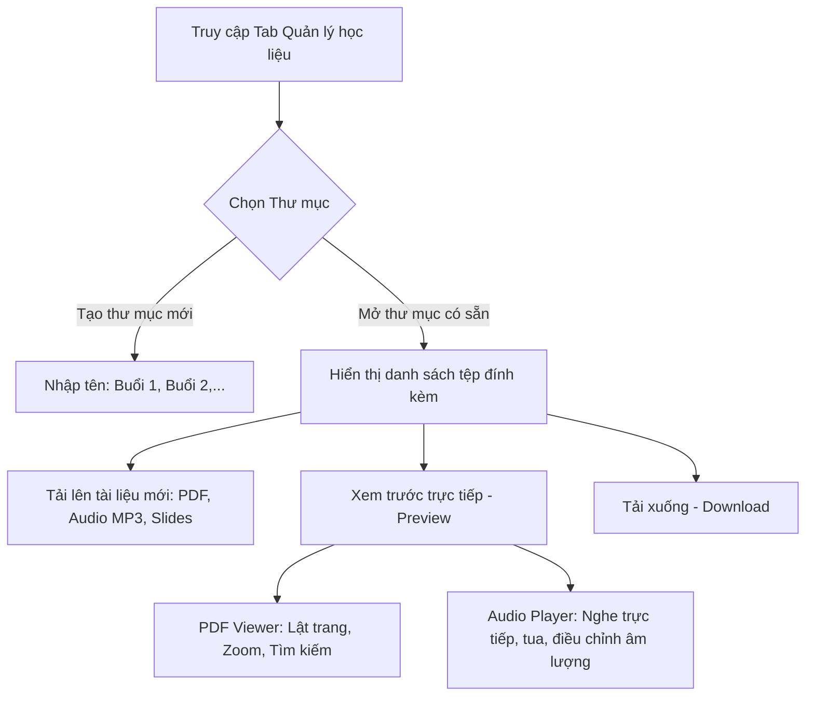
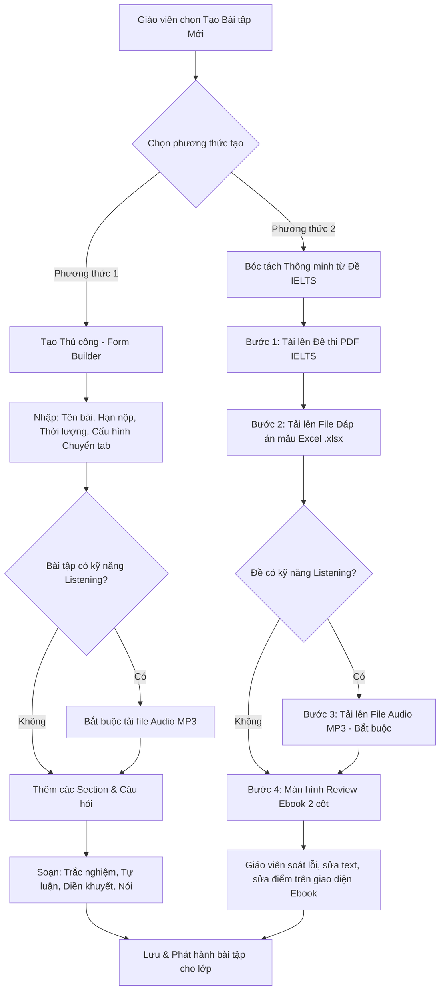

# KẾ HOẠCH TRIỂN KHAI & BẢN THIẾT KẾ KỸ THUẬT: MODULE HỌC LIỆU & BÀI TẬP IELTS
**Hệ thống LMS Công ty Cổ phần SIMPACE Việt Nam**
*Ngày lập: 15/10/2026 | Tuân thủ tuyệt đối nguyên tắc AGENTS.md*

---

## MỤC LỤC
1. [Cơ chế Sao lưu & Rollback An toàn (Safeguard Protocol)](#1-cơ-chế-sao-lưu--rollback-an-toàn-safeguard-protocol)
2. [Bước 1: Phân tích & Đặc tả Luồng nghiệp vụ (Workflow & User Flow)](#2-bước-1-phân-tích--đặc-tả-luồng-nghiệp-vụ-workflow--user-flow)
   - [2.1. Bố cục & Vị trí điều hướng cho 5 Vai trò](#21-bố-cục--vị-trí-điều-hướng-cho-5-vai-trò)
   - [2.2. Ma trận phân quyền (RBAC Matrix)](#22-ma-trận-phân-quyền-rbac-matrix)
   - [2.3. Luồng Module 1: Quản lý Học liệu (Folder Tree Architecture)](#23-luồng-module-1-quản-lý-học-liệu-folder-tree-architecture)
   - [2.4. Luồng Module 2: Quản lý Bài tập (Manual & Smart IELTS Parser)](#24-luồng-module-2-quản-lý-bài-tập-manual--smart-ielts-parser)
   - [2.5. Cơ chế Giám sát Chống gian lận (Tab-switch Monitoring)](#25-cơ-chế-giám-sát-chống-gian-lận-tab-switch-monitoring)
3. [Bước 2: Thiết kế Cơ sở Dữ liệu Tăng dần (Incremental DB Modeling)](#3-bước-2-thiết-kế-cơ-sở-dữ-liệu-tăng-dần-incremental-db-modeling)
4. [Bước 3: Bản thiết kế Giao diện UI & Design System](#4-bước-3-bản-thiết-kế-giao-diện-ui--design-system)
5. [Lộ trình Triển khai Code & Kịch bản Kiểm thử](#5-lộ-trình-triển-khai-code--kịch-bản-kiểm-thử)

---

## 1. CƠ CHẾ SAO LƯU & ROLLBACK AN TOÀN (SAFEGUARD PROTOCOL)

Để đảm bảo toàn vẹn tuyệt đối mã nguồn hiện tại (gồm toàn bộ module Người dùng, Trường học, Lớp học, Cấu hình IELTS, Phân lớp hàng loạt và Suggetion) và loại bỏ 100% rủi ro hỏng code cũ:

### 1.1. Các điểm sao lưu đã tạo thành công
- **Git Commit gốc ổn định:** `54abd16` (*feat(users): chi hien thi tab nhap hang loat va phan lop IELTS khi chon vai tro Hoc sinh*)
- **Git Tag cố định:** `v1.0-stable-core`
- **Git Branch dự phòng:** `backup-stable-before-materials-assignments`

### 1.2. Lệnh Rollback 1 bước khi cần hoàn tác
Nếu trong quá trình triển khai có bất kỳ điểm nào không như ý, chỉ cần chạy đúng 1 câu lệnh sau trên Terminal để đưa hệ thống về chính xác trạng thái hiện tại:
```powershell
git reset --hard v1.0-stable-core
```
Hoặc chuyển hẳn sang nhánh an toàn:
```powershell
git checkout backup-stable-before-materials-assignments
```

### 1.3. Nguyên tắc phát triển "Additive-Only" (Chỉ thêm mới, không can thiệp code cũ)
1. **Không sửa đổi hoặc xóa bất kỳ bảng / cột hiện hữu nào** trong `prisma/schema.prisma`. Bảng `User`, `UserProfile`, `School`, `Class`, `ClassAssignment`, `ClassEnrollment`, `IeltsLevel` được bảo toàn nguyên vẹn.
2. **Không làm thay đổi cấu trúc của `ClassDetailView` hiện tại:**
   - Giữ nguyên 100% toàn bộ giao diện và logic hiện hữu trong **Tab 1: "Thông tin lớp & Học viên"**.
   - Các tính năng gán GV, gán TA, thêm/gỡ học sinh, chuyển lớp, check trùng lịch của lớp vẫn hoạt động hoàn hảo như cũ.
   - Tab 2 ("Quản lý học liệu") và Tab 3 ("Quản lý bài tập") được cấu trúc thành các module con hoàn toàn độc lập.

---

## 2. BƯỚC 1: PHÂN TÍCH & ĐẶC TẢ LUỒNG NGHIỆP VỤ (WORKFLOW & USER FLOW)

### 2.1. Bố cục & Vị trí điều hướng cho 5 Vai trò

Hệ thống được tổ chức trực quan theo 2 tầng giao diện:

#### Tầng 1 (Trọng tâm) - Thanh 3 Sub-tabs tại Màn hình "Chi tiết lớp học" (`ClassDetailView`):
Khi người dùng bấm vào xem chi tiết một lớp học bất kỳ, phía đầu trang có thanh chuyển đổi tab chuẩn design system:
```
[ 🎓 Tab 1: Thông tin lớp & Học viên ]   [ 📁 Tab 2: Quản lý học liệu ]   [ 📝 Tab 3: Quản lý bài tập ]
```
- **Tab 1: Thông tin lớp & Học viên:** Giữ nguyên 100% giao diện quản lý sĩ số, nhân sự, lịch học, danh sách học sinh hiện tại.
- **Tab 2: Quản lý học liệu:** Cây thư mục (Folder Tree) lưu trữ giáo trình, slide bài giảng, file audio nghe theo từng buổi học của lớp đó.
- **Tab 3: Quản lý bài tập:** Danh sách bài tập được giao cho lớp, nút "Tạo bài tập mới" (thủ công hoặc bóc tách đề), bảng thống kê nộp bài và chấm điểm học sinh.

#### Tầng 2 - Menu chuyên biệt trên Sidebar chính (Tùy theo Vai trò):
- **Quản trị viên (Admin):** Có mục **"Kho học liệu chung"** trên Sidebar để quản lý học liệu theo từng Trình độ IELTS (`Cơ bản`, `Trung bình`, `Nâng cao`) áp dụng cho toàn hệ thống.
- **Giáo viên (Teacher):** Có mục **"Kho học liệu"** (học liệu của các lớp đang phụ trách) và **"Bài tập cần chấm"** (gom toàn bộ bài tập cần chấm điểm của tất cả các lớp vào một nơi).
- **Trợ giảng (Teaching Assistant):** Truy cập vào các lớp được phân công để hỗ trợ chấm bài trắc nghiệm/tự luận và xem trước/tải học liệu.
- **Quản nhiệm trường (School Manager):** Xem và tải học liệu, theo dõi tiến độ nộp bài và kết quả học tập của các lớp thuộc trường mình quản lý.
- **Học sinh (Student):** Có mục **"Học liệu của tôi"** (xem/tải tài liệu các lớp đang học) và **"Bài tập cần làm"** (danh sách bài tập chưa làm / đã nộp, thời hạn nộp bài, điểm số và nhận xét của giáo viên).

---

### 2.2. Ma trận phân quyền (RBAC Matrix)

| Hành động nghiệp vụ | Admin | Giáo viên | Trợ giảng | Quản nhiệm | Học sinh |
| :--- | :---: | :---: | :---: | :---: | :---: |
| Quản lý Thư mục & Upload Học liệu Chung (theo Level IELTS) |  Full | ❌ | ❌ | ❌ | ❌ |
| Quản lý Thư mục & Upload Học liệu Lớp học |  Full |  (Lớp phụ trách) | ❌ | ❌ | ❌ |
| Xem trước (Preview PDF, Nghe Audio MP3) trực tiếp trên Web |  Có |  Có |  Có |  Có |  Có |
| Tải file học liệu xuống máy tính (Download) |  Có |  Có |  Có |  Có |  Có |
| Tạo bài tập mới (Thủ công hoặc Bóc tách tự động) |  Có |  (Lớp phụ trách) | ❌ | ❌ | ❌ |
| Đóng/Mở hạn nộp bài tập |  Có |  (Lớp phụ trách) | ❌ | ❌ | ❌ |
| Làm bài tập & Nộp bài trực tuyến (giao diện Ebook) | ❌ | ❌ | ❌ | ❌ |  (Học sinh lớp đó) |
| Chấm điểm bài tập & Ghi nhận xét |  Có |  (Lớp phụ trách) |  (Hỗ trợ) | ❌ | ❌ |
| Xem điểm, bài chữa, nhận xét của giáo viên |  Có |  Có |  Có |  (Học sinh trường) |  (Bài làm của mình) |

---

### 2.3. Luồng Module 1: Quản lý Học liệu (Folder Tree Architecture)



- **Tổ chức phân cấp Thư mục (Folder Hierarchy):**
  - Thư mục gốc: Phân chia theo Buổi học (`Buổi 01 - Listening Overview`, `Buổi 02 - Reading Skimming & Scanning`,...).
  - Hỗ trợ tạo thư mục con lồng nhau không giới hạn cấp độ.
- **Tương tác trực tiếp trên trình duyệt:**
  - **PDF Preview:** Sử dụng trình xem PDF tích hợp, cho phép đọc toàn màn hình, lật trang, zoom in/out mà không cần tải về máy.
  - **Audio Player:** Trình phát âm thanh thanh lịch gắn sẵn trong giao diện, có thanh tiến trình (progress bar), thời lượng, nút tua tiến/lùi 5s, điều khiển âm lượng.
  - **Download:** Tải file gốc về máy tính với 1 click.
  - **Xóa mềm (Soft-delete):** Giữ an toàn dữ liệu lịch sử, giáo viên có thể khôi phục tài liệu đã xóa nếu cần.

---

### 2.4. Luồng Module 2: Quản lý Bài tập (Manual & Smart IELTS Parser)

Bài tập hỗ trợ đủ **cả 4 kỹ năng IELTS (Listening, Reading, Writing, Speaking)** với 2 phương thức tạo bài:



#### Quy trình 4 bước Bóc tách Đề thi IELTS Thông minh:
1. **Bước 1 - Tải Đề thi PDF:** Hệ thống tiếp nhận file PDF đề thi IELTS (chuẩn cấu trúc Cambridge / Mini Practice Book). Bộ xử lý OCR/Parser bóc tách đoạn văn (Passage), đề mục (Section 1..4, Reading Passage 1..3), số thứ tự câu hỏi và nội dung câu hỏi.
2. **Bước 2 - Tải File Đáp án mẫu Excel (`.xlsx`):**
   - Áp dụng cho kỹ năng **Reading** và **Listening** (Writing và Speaking không cần file Excel vì giáo viên chấm tay theo rubric IELTS).
   - Format file Excel mẫu tiêu chuẩn:
     | Cột A: Câu số | Cột B: Kỹ năng | Cột C: Dạng câu hỏi | Cột D: Đáp án đúng | Cột E: Điểm số | Cột F: Giải thích chi tiết |
     | :--- | :--- | :--- | :--- | :--- | :--- |
     | 1 | LISTENING | MULTIPLE_CHOICE | B | 1.0 | Nghe thấy keyword 'train station' |
     | 2 | LISTENING | FILL_IN_BLANK | library | 1.0 | Chính tả đúng từ 'library' |
     | 14 | READING | TRUE_FALSE_NG | TRUE | 1.0 | Khớp với đoạn 2 dòng 4 |
3. **Bước 3 - Tải File Audio (`.mp3`):**
   - **RÀNG BUỘC KỸ THUẬT BẮT BUỘC:** Nếu đề thi có chứa phần nghe (Listening), form sẽ yêu cầu giáo viên đính kèm file Audio `.mp3`. Nếu chưa có file nghe, nút chuyển sang Bước 4 sẽ bị vô hiệu hóa kèm thông báo cảnh báo rõ ràng.
4. **Bước 4 - Giao diện Review Ebook 2 Cột (Split-screen Review):**
   - Cột trái: Hiển thị Đề bài / Bài đọc (Passage) + Trình phát Audio nghe (với bài Listening).
   - Cột phải: Danh sách câu hỏi bóc tách tự động kèm đáp án và điểm tương ứng từ file Excel.
   - Giáo viên được toàn quyền click trực tiếp để sửa nội dung văn bản, sửa đáp án, điều chỉnh điểm số trước khi ấn nút "Lưu bài tập".

---

### 2.5. Cơ chế Giám sát Chống gian lận (Tab-switch Monitoring)

Để giải quyết bài toán thi cử trung thực khi học viên làm bài trực tuyến:
- **Công nghệ nền tảng:** Sử dụng chuẩn `Page Visibility API` kết hợp sự kiện `window.onblur` và `window.onfocus`.
- **Cơ chế ghi nhận vi phạm:**
  1. Khi học sinh bấm "Bắt đầu làm bài", màn hình chuyển sang chế độ làm bài toàn màn hình (Fullscreen Focus).
  2. Bất cứ khi nào học sinh chuyển sang tab khác, mở ứng dụng khác hoặc thu nhỏ trình duyệt:
     - Biến đếm vi phạm `tabSwitchCount` tăng thêm 1.
     - Màn hình lập tức hiện **Modal Cảnh báo đỏ**: *"Cảnh báo: Bạn vừa rời khỏi màn hình làm bài! Lần vi phạm: X / N. Nếu vi phạm quá số lần quy định, hệ thống sẽ tự động thu bài."*
  3. **Ngưỡng vi phạm:** Số lần vi phạm tối đa ($N$) được cấu hình trong Cài đặt Trình độ IELTS (mặc định: 3 lần) hoặc giáo viên tùy chỉnh khi tạo bài.
  4. **Tự động thu bài & Khóa thi (Auto-submit):**
     - Khi `tabSwitchCount > maxTabSwitchCount`: Hệ thống tự động lưu toàn bộ các câu đã làm, gửi bài nộp về máy chủ ngay lập tức.
     - Khóa giao diện làm bài, thông báo: *"Bạn đã vi phạm quy chế thi (chuyển tab quá số lần cho phép). Bài làm của bạn đã được tự động nộp và ghi nhận vi phạm."*
     - Gắn cờ vi phạm `isCheatingFlagged: true` và lưu số lần rời màn hình trong bản ghi `AssignmentSubmission`.
  5. **Giao diện Giáo viên khi chấm bài:**
     - Hiển thị huy hiệu cảnh báo nổi bật màu đỏ: `⚠️ Vi phạm chuyển tab: 4 lần (Tự động thu bài)`.
     - Giáo viên có căn cứ để trừ điểm hoặc hủy kết quả bài thi tùy theo quy chế của trung tâm.

---

## 3. BƯỚC 2: THIẾT KẾ CƠ SỞ DỮ LIỆU TĂNG DẦN (INCREMENTAL DB MODELING)

Các bảng mới được bổ sung vào `prisma/schema.prisma` theo mô hình quan hệ chặt chẽ, sử dụng khóa ngoại trỏ tới các bảng hiện tại (`Class`, `User`, `IeltsLevel`), hoàn toàn không làm đứt gãy dữ liệu cũ:

```mermaid
erDiagram
    Class ||--o{ MaterialFolder : "chứa"
    IeltsLevel ||--o{ MaterialFolder : "học liệu chung"
    MaterialFolder ||--o{ MaterialFolder : "thư mục con"
    MaterialFolder ||--o{ LearningMaterial : "chứa file"
    
    Class ||--o{ Assignment : "giao bài"
    Assignment ||--o{ AssignmentQuestion : "gồm các câu hỏi"
    AssignmentQuestion ||--o{ QuestionOption : "các đáp án A/B/C/D"
    Assignment ||--o{ AssignmentSubmission : "học sinh nộp"
    User ||--o{ AssignmentSubmission : "thực hiện bởi"
    AssignmentSubmission ||--o{ SubmissionAnswer : "chi tiết câu trả lời"
    AssignmentQuestion ||--o{ SubmissionAnswer : "thuộc câu hỏi"
```

### Chi tiết các Model Prisma mới:

```prisma
// ==========================================
// 8. MODULE QUẢN LÝ HỌC LIỆU (LEARNING MATERIALS)
// ==========================================

enum MaterialType {
  PDF           // Tài liệu giáo trình, bài đọc PDF
  AUDIO         // File nghe MP3/WAV
  DOCUMENT      // Word DOCX, PPT, Excel
  VIDEO         // Video bài giảng
  OTHER         // Tệp tin khác
}

model MaterialFolder {
  id           String             @id @default(uuid())
  name         String             // Tên thư mục (VD: Buổi 1 - Reading Skills)
  description  String?
  classId      String?            // Gắn với Lớp học cụ thể (Null nếu là Học liệu chung)
  ieltsLevelId String?            // Gắn với Trình độ IELTS chung (Null nếu là Học liệu lớp)
  parentId     String?            // Thư mục cha (hỗ trợ cây thư mục vô hạn cấp)
  createdById  String             // Người tạo (Admin hoặc Giáo viên)
  sortOrder    Int                @default(0)
  isActive     Boolean            @default(true) // Xóa mềm
  createdAt    DateTime           @default(now())
  updatedAt    DateTime           @updatedAt

  class        Class?             @relation(fields: [classId], references: [id], onDelete: Cascade)
  ieltsLevel   IeltsLevel?        @relation(fields: [ieltsLevelId], references: [id], onDelete: Cascade)
  parent       MaterialFolder?    @relation("FolderHierarchy", fields: [parentId], references: [id], onDelete: Cascade)
  subFolders   MaterialFolder[]   @relation("FolderHierarchy")
  materials    LearningMaterial[]

  @@index([classId])
  @@index([ieltsLevelId])
  @@index([parentId])
  @@map("material_folders")
}

model LearningMaterial {
  id           String         @id @default(uuid())
  folderId     String         // Thuộc thư mục nào
  title        String         // Tên tài liệu hiển thị
  fileUrl      String         // Đường dẫn file (Local storage hoặc Supabase Storage)
  fileName     String         // Tên file gốc
  fileSize     Int            // Dung lượng file (bytes)
  fileType     MaterialType   @default(PDF)
  mimeType     String?        // application/pdf, audio/mpeg,...
  uploadedById String         // Người tải lên
  downloadCount Int           @default(0)
  isActive     Boolean        @default(true) // Xóa mềm
  createdAt    DateTime       @default(now())
  updatedAt    DateTime       @updatedAt

  folder       MaterialFolder @relation(fields: [folderId], references: [id], onDelete: Cascade)

  @@index([folderId])
  @@map("learning_materials")
}

// ==========================================
// 9. MODULE QUẢN LÝ BÀI TẬP (ASSIGNMENTS & EXAMS)
// ==========================================

enum AssignmentSkill {
  ALL_SKILLS    // Full 4 kỹ năng
  READING       // Kỹ năng Đọc
  LISTENING     // Kỹ năng Nghe
  WRITING       // Kỹ năng Viết
  SPEAKING      // Kỹ năng Nói
}

enum AssignmentType {
  HOMEWORK      // Bài tập về nhà
  QUIZ          // Bài kiểm tra ngắn trên lớp
  MIDTERM       // Thi giữa kỳ
  MOCK_EXAM     // Thi thử IELTS mô phỏng
}

enum QuestionType {
  MULTIPLE_CHOICE // Trắc nghiệm 1 đáp án
  MULTIPLE_SELECT // Trắc nghiệm nhiều đáp án đúng
  FILL_IN_BLANK   // Điền từ / Điền khuyết
  TRUE_FALSE_NG   // Dạng True / False / Not Given
  ESSAY           // Tự luận (Writing Task 1 & 2)
  SPEAKING_RECORD // Ghi âm nói (Speaking Part 1, 2, 3)
}

enum SubmissionStatus {
  NOT_STARTED   // Chưa bắt đầu
  IN_PROGRESS   // Đang làm bài
  SUBMITTED     // Đã nộp, chờ chấm
  GRADED        // Đã chấm điểm hoàn tất
}

model Assignment {
  id                 String               @id @default(uuid())
  classId            String               // Bài tập của lớp học nào
  title              String               // Tiêu đề bài tập (VD: Reading Passage 1 - Mini Test 01)
  description        String?              // Hướng dẫn làm bài
  skill              AssignmentSkill      @default(READING)
  type               AssignmentType       @default(HOMEWORK)
  durationMinutes    Int?                 // Thời lượng làm bài (phút) - Null là không giới hạn
  dueDate            DateTime?            // Hạn chót nộp bài
  maxAttempts        Int                  @default(1) // Số lần được làm bài
  audioUrl           String?              // Bắt buộc đính kèm nếu kỹ năng có Listening
  
  // Cấu hình giám sát chống gian lận
  enableProctoring   Boolean              @default(true) // Bật giám sát chuyển tab
  maxTabSwitches     Int                  @default(3)    // Số lần tối đa trước khi tự thu bài
  
  createdById        String               // Giáo viên hoặc Admin tạo bài
  isActive           Boolean              @default(true) // Xóa mềm
  createdAt          DateTime             @default(now())
  updatedAt          DateTime             @updatedAt

  class              Class                @relation(fields: [classId], references: [id], onDelete: Cascade)
  questions          AssignmentQuestion[]
  submissions        AssignmentSubmission[]

  @@index([classId])
  @@index([dueDate])
  @@map("assignments")
}

model AssignmentQuestion {
  id               String               @id @default(uuid())
  assignmentId     String
  questionNumber   Int                  // Câu số mấy (1, 2, 3,...)
  passageText      String?              // Đoạn văn đọc hiểu / Bối cảnh câu hỏi (nếu có)
  prompt           String               // Đề bài câu hỏi
  type             QuestionType         @default(MULTIPLE_CHOICE)
  points           Float                @default(1.0) // Điểm số của câu
  correctAnswer    String?              // Đáp án đúng (đối với Trắc nghiệm / Điền từ)
  explanation      String?              // Lời giải thích / Giải đề chi tiết
  orderIndex       Int                  @default(0)

  assignment       Assignment           @relation(fields: [assignmentId], references: [id], onDelete: Cascade)
  options          QuestionOption[]
  submissionAnswers SubmissionAnswer[]

  @@index([assignmentId])
  @@index([orderIndex])
  @@map("assignment_questions")
}

model QuestionOption {
  id          String             @id @default(uuid())
  questionId  String
  optionLabel String             // A, B, C, D
  content     String             // Nội dung đáp án
  isCorrect   Boolean            @default(false)

  question    AssignmentQuestion @relation(fields: [questionId], references: [id], onDelete: Cascade)

  @@index([questionId])
  @@map("question_options")
}

model AssignmentSubmission {
  id                 String             @id @default(uuid())
  assignmentId       String
  studentId          String             // Học sinh thực hiện
  attemptNumber      Int                @default(1)
  startedAt          DateTime           @default(now())
  submittedAt        DateTime?
  status             SubmissionStatus   @default(IN_PROGRESS)
  score              Float?             // Tổng điểm đạt được
  totalPoints        Float?             // Thang điểm tối đa
  teacherFeedback    String?            // Nhận xét tổng thể của giáo viên
  gradedById         String?            // Giáo viên / Trợ giảng chấm điểm

  // Dữ liệu giám sát thi
  tabSwitchCount     Int                @default(0)
  isCheatingFlagged  Boolean            @default(false)
  autoSubmittedReason String?           // Lý do tự nộp: "VIOLATED_TAB_SWITCH_LIMIT", "TIME_EXPIRED"

  assignment         Assignment         @relation(fields: [assignmentId], references: [id], onDelete: Cascade)
  student            User               @relation(fields: [studentId], references: [id], onDelete: Cascade)
  answers            SubmissionAnswer[]

  @@unique([assignmentId, studentId, attemptNumber])
  @@index([assignmentId])
  @@index([studentId])
  @@map("assignment_submissions")
}

model SubmissionAnswer {
  id             String             @id @default(uuid())
  submissionId   String
  questionId     String
  studentAnswer  String?            // Câu trả lời dạng text / A, B, C / bài luận
  audioUrl       String?            // File ghi âm câu trả lời speaking (nếu có)
  isCorrect      Boolean?           // Kết quả trắc nghiệm tự chấm
  awardedPoints  Float?             // Điểm thực tế đạt được
  teacherComment String?            // Nhận xét chi tiết cho từng câu

  submission     AssignmentSubmission @relation(fields: [submissionId], references: [id], onDelete: Cascade)
  question       AssignmentQuestion   @relation(fields: [questionId], references: [id], onDelete: Cascade)

  @@index([submissionId])
  @@index([questionId])
  @@map("submission_answers")
}
```

---

## 4. BƯỚC 3: BẢN THIẾT KẾ GIAO DIỆN UI & DESIGN SYSTEM

### 4.1. Quy chuẩn Thẩm mỹ & Màu sắc Thương hiệu SIMPACE
- **Màu thương hiệu chủ đạo:** Cam SIMPACE `#EA580C` (`orange-600`), nhấn đậm `#C2410C` (`orange-700`), nền nhạt `bg-orange-50` viền `border-orange-200`.
- **Màu chữ & Khối:** Tiêu đề đậm `#0F172A` (Slate 900), chữ phụ `#64748B` (Slate 500), viền thẻ `#E2E8F0` (Slate 200).
- **Bo góc & Hiệu ứng:** `rounded-2xl` cho các Card chính, `rounded-xl` cho các nút bấm và ô nhập liệu, bóng đổ nhẹ `shadow-sm` tạo cảm giác hiện đại, sạch sẽ.
- **Ngôn ngữ:** 100% Tiếng Việt chuẩn hóa giáo dục, văn phong thân thiện, chuyên nghiệp.

### 4.2. Chi tiết Giao diện 3 Sub-tabs trong `ClassDetailView`

```
+-------------------------------------------------------------------------------------------------------------+
|  <- Quay lại danh sách lớp học                                                [ Chỉnh sửa thông tin lớp ]  |
|                                                                                                             |
|  [ 🎓 Thông tin lớp & Học viên ]     [ 📁 Quản lý học liệu (12) ]     [ 📝 Quản lý bài tập (5) ]            |
+-------------------------------------------------------------------------------------------------------------+
```

#### Giao diện Tab 2: Quản lý học liệu (Folder Explorer View)
- Phía trên: Thanh công cụ gồm nút `+ Tạo thư mục mới`, `Tải tệp lên`, ô tìm kiếm tài liệu nhanh.
- Breadcrumb điều hướng: `Thư mục gốc > Buổi 01 - Listening Section 1`.
- Lưới danh mục hiển thị dạng Grid hoặc Table:
  - Icon phân loại file trực quan: PDF (Đỏ cam), Audio (Tím), DOCX (Xanh dương).
  - Tên file, dung lượng, người tải, ngày tải.
  - Các nút tác vụ nhanh: **Xem trước (Preview)**, **Tải xuống (Download)**, **Đổi tên**, **Xóa mềm**.
- **Modal Preview:**
  - Đối với PDF: Trình đọc PDF nhúng có thanh điều hướng số trang.
  - Đối với Audio: Player phát nhạc có thanh chạy sóng âm thanh trực tiếp trên web.

#### Giao diện Tab 3: Quản lý bài tập (Assignment Dashboard)
- Nút tác vụ nổi bật: `+ Giao bài tập mới` với menu thả xuống:
  - *Tạo thủ công (Soạn từng câu hỏi)*
  - *Bóc tách thông minh từ Đề IELTS (PDF + Excel + Audio)*
- Thẻ thống kê nhanh: `Tổng số bài tập đã giao`, `Bài tập đang mở hạn`, `Bài tập cần chấm điểm`.
- Bảng danh sách bài tập: Tên bài, Kỹ năng (Badge màu riêng: Reading xanh lá, Listening xanh dương, Writing tím, Speaking cam), Hạn nộp, Tỷ lệ nộp bài (`18/25 học viên`), Trạng thái, Nút `Xem & Chấm bài`.

#### Giao diện Làm bài & Preview Ebook 2 Cột (Ebook Split-Screen):
- **Cột trái (50% màn hình):**
  - Chứa bài đọc (Passage) hoặc đề thi gốc với cỡ chữ tùy chỉnh (tăng/giảm font).
  - Trình phát Audio nổi trên cùng nếu có kỹ năng Listening (cho phép tạm dừng, tua lại).
- **Cột phải (50% màn hình):**
  - Thanh đếm ngược thời gian làm bài (Countdown Timer).
  - Danh sách câu hỏi được đánh số thứ tự từ 1 đến $N$.
  - Ô chọn đáp án trắc nghiệm (A, B, C, D) hoặc ô nhập văn bản (cho bài Writing / Điền khuyết).
  - Nút nộp bài cố định ở góc dưới cùng bên phải.
- **Thanh cảnh báo Giám sát thi (Anti-Cheating Bar):** Hiển thị trạng thái giám sát: `🟢 Chế độ giám sát thi đang bật - Số lần rời màn hình: 0/3`.

---

## 5. LỘ TRÌNH TRIỂN KHAI CODE & KỊCH BẢN KIỂM THỬ

Sau khi thảo luận và chốt thống nhất bản kế hoạch này với nhóm, tiến trình triển khai sẽ được thực hiện theo đúng 3 bước chuẩn:

1. **Bước 1 (Đã hoàn thành):** Tạo Git Tag và Branch snapshot an toàn, viết tài liệu đặc tả luồng chi tiết.
2. **Bước 2:** Bổ sung CSDL vào `prisma/schema.prisma`, đồng bộ Supabase bằng `npx prisma db push`.
3. **Bước 3:** Tạo Server Actions:
   - `src/actions/materials.ts`: CRUD Thư mục, tải file học liệu, xem trước, tải về, xóa mềm.
   - `src/actions/assignments.ts`: Tạo bài thủ công, bộ parser bóc tách PDF + Excel + Audio, nộp bài, ghi nhận vi phạm chuyển tab, chấm điểm bài tập.
4. **Bước 4:** Xây dựng Component giao diện chuẩn Design System:
   - Tích hợp hệ thống 3 Tab vào `ClassDetailView`.
   - Xây dựng Component Quản lý Học liệu (Folder Tree + File Viewer).
   - Xây dựng Component Quản lý Bài tập (Danh sách, Form tạo bài, Ebook 2 cột, Giám sát chuyển tab, Màn hình chấm bài).
5. **Bước 5:** Kiểm thử thực tế (Testing):
   - Thử nghiệm tải file PDF đề IELTS và file Excel đáp án mẫu để bóc tách tự động.
   - Thử nghiệm bắt buộc tải file Audio cho bài nghe.
   - Thử nghiệm mô phỏng chuyển tab xem hệ thống cảnh báo và tự động thu bài sau 3 lần vi phạm.
   - Xác minh toàn bộ code cũ của lớp học (gán GV, thêm học sinh, chuyển lớp) vẫn chạy bình thường 100%.
