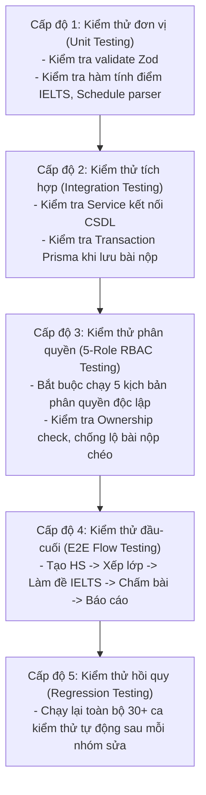
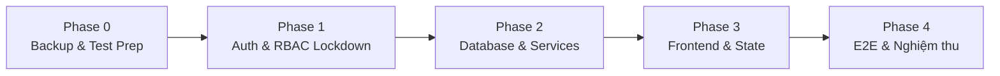

# KẾ HOẠCH PHÁT TRIỂN & SỬA LỖI HỆ THỐNG LMS SIMPACE BẰNG TEAMWORK
**Tài liệu quy chuẩn: TEAMWORK_DEVELOPMENT_PLAN.md**
**Dự án: Hệ thống LMS Công ty Cổ phần SIMPACE Việt Nam**
**Đơn vị thực hiện: Đội ngũ Teamwork Multi-Agent (MIS KLTN 2026)**
**Phiên bản: 1.1 (Cập nhật Quản trị rủi ro, QA 5 cấp độ, Contract-First & Human-in-the-loop)**
**Ngày cập nhật: 06/11/2026**

---

## MỤC LỤC
1. [Nguyên tắc cốt lõi & Bản đồ năng lực thực tế](#1-nguyên-tắc-cốt-lõi--bản-đồ-năng-lực-thực-tế)
2. [Cơ cấu tổ chức & Phân vai Agent tối ưu](#2-cơ-cấu-tổ-chức--phân-vai-agent-tối-ưu)
3. [Chiến lược Quản trị rủi ro & An toàn dữ liệu](#3-chiến-lược-quản-trị-rủi-ro--an-toàn-dữ-liệu)
4. [Kiểm soát tích hợp & Quy chuẩn Contract-First DTO](#4-kiểm-soát-tích-hợp--quy-chuẩn-contract-first-dto)
5. [Quy trình QA & Kiểm thử 5 cấp độ](#5-quy-trình-qa--kiểm-thử-5-cấp-độ)
6. [Cơ chế phê duyệt hồ sơ nhiệm vụ & Cổng Human-in-the-loop](#6-cơ-chế-phê-duyệt-hồ-sơ-nhiệm-vụ--cổng-human-in-the-loop)
7. [Lộ trình triển khai 5 Phase chi tiết (Từ Phase 0 đến Phase 4)](#7-lộ-trình-triển-khai-5-phase-chi-tiết-từ-phase-0-đến-phase-4)
8. [Ma trận phân công trách nhiệm (RACI Matrix v1.1)](#8-ma-trận-phân-công-trách-nhiệm-raci-matrix-v11)

---

## 1. NGUYÊN TẮC CỐT LÕI & BẢN ĐỒ NĂNG LỰC THỰC TẾ

Để bảo đảm tính khả thi trong bối cảnh đồ án tốt nghiệp MIS (nhóm 3 sinh viên, Agile 1 tháng), quy trình phát triển bằng Teamwork phải phân định minh bạch giữa **Năng lực nền tảng đã kiểm chứng thực tế** và **Quy ước vận hành do Lead giám sát**:

### 1.1. Bảng đối chiếu năng lực thực tế (Reality Check)
| Năng lực | Phân loại | Minh chứng thực nghiệm trong hệ thống | Giới hạn & Điểm nghẽn cần lưu ý |
|---|---|---|---|
| **Mô hình Hub-and-Spoke** | Đã kiểm chứng 100% | `explorer_r1/r2/r3` đều có `Parent: orchestrator`, nhận lệnh qua `DISPATCH.md` | Các Subagents **không thể gửi tin nhắn ngang hàng (P2P)**; mọi trao đổi liên nhánh bắt buộc phải qua Lead. |
| **Phân quyền công cụ (Tool Scoping)** | Đã kiểm chứng 100% | Auditor & Reviewer dùng Read-only tools; Dev dùng Read/Write tools | Phải cấu hình cẩn thận `EnableWriteTools: false` cho Reviewer để tránh sửa nhầm mã nguồn. |
| **Không gian làm việc cách ly** | Đã kiểm chứng 100% | Subagent hỗ trợ `Workspace: 'branch'` tạo worktree riêng biệt | Cần merge tuần tự để tránh xung đột mã nguồn. |
| **Kiểm tra trạng thái tệp (Git Diff)** | Đã kiểm chứng 100% | Lệnh `git status --porcelain` và `git diff` chạy độc lập | Phải kiểm tra trước khi commit hoặc chuyển giao sang QA. |
| **Kiểm tra biên dịch tĩnh (Type Check)** | Đã kiểm chứng 100% | Lệnh `npx tsc --noEmit` xác định 0 lỗi TypeScript | **Tuyệt đối không được coi `tsc` là bằng chứng duy nhất** (TypeScript không kiểm tra được logic nghiệp vụ, bảo mật RBAC hay dữ liệu rỗng). |
| **Khóa tệp đơn nhiệm (Single-writer Mutex)** | Quy ước vận hành | Lead phân bổ danh sách file trong `plan.md` | Hệ điều hành không tự khóa tệp; Lead phải chịu trách nhiệm không dispatch 2 Dev cùng ghi 1 file. |
| **Cổng dừng Human-in-the-loop** | Quy ước vận hành | Lead dừng tiến trình và xin chỉ thị người dùng | Đòi hỏi Lead phải nhận diện đúng các thao tác nhạy cảm (migration, auth, delete). |

---

## 2. CƠ CẤU TỔ CHỨC & PHÂN VAI AGENT TỐI ƯU

Đội ngũ Teamwork duy trì **6 vị trí Agent chuyên trách**, kết hợp giữa chuyên môn kỹ thuật và tính độc lập kiểm soát:

```
                       ┌─────────────────────────┐
                       │    NGƯỜI DÙNG (BẠN)     │
                       │   (Phê duyệt tối cao)   │
                       └────────────┬────────────┘
                                    │ (Cổng Human-in-the-loop)
                       ┌────────────▼────────────┐
                       │    PROJECT SENTINEL     │
                       │ (Giám sát & Quản trị)   │
                       └────────────┬────────────┘
                                    │ (Ủy quyền điều phối)
                       ┌────────────▼────────────┐
                       │   PROJECT ORCHESTRATOR  │
                       │  (Tech Lead Điều phối)  │
                       └─────┬─────────────┬─────┘
           ┌─────────────────┘             └─────────────────┐
           │ (Contract-First DTO / File Lock)                │ (Yêu cầu thẩm định chéo)
┌──────────▼──────────┐                           ┌──────────▼──────────┐
│ BACKEND & DB DEV    │                           │    CODE REVIEWER    │
│ (Action, Service,   │                           │ (Phản biện độc lập, │
│  Prisma, Schema)    │                           │  Read-only Tools)   │
└──────────┬──────────┘                           └──────────┬──────────┘
           │ (Bàn giao Interfaces & DTO)                     │
┌──────────▼──────────┐                           ┌──────────▼──────────┐
│ FRONTEND & UI DEV   │                           │      QA TESTER      │
│ (Component, State,  │                           │ (Unit, Integration, │
│  Tailwind, Hooks)   │                           │  E2E, 5-Role RBAC)  │
└─────────────────────┘                           └──────────┬──────────┘
                                                             │
                                                  ┌──────────▼──────────┐
                                                  │ POST-VICTORY AUDITOR│
                                                  │ (Kiểm toán độc lập) │
                                                  └─────────────────────┘
```

### Chi tiết quyền hạn & Không gian làm việc:
1. **Tech Lead (Orchestrator):** Full Tools + Quản trị Subagent (`Workspace: 'inherit'`). Chịu trách nhiệm phân rã bài toán, quản lý File Mutex, kiểm tra tương thích giữa các module và tổng hợp hồ sơ phê duyệt.
2. **Backend & DB Developer:** Read/Write Tools (`Workspace: 'branch'`). Chịu trách nhiệm xây dựng 4 Services còn thiếu, loại bỏ mock fallback ngầm, sửa lỗi khóa ngoại P2003, chuẩn hóa DTO/Interfaces và bảo đảm phân quyền ở tầng Action/Service.
3. **Frontend & UI Developer:** Read/Write Tools (`Workspace: 'branch'`). Chịu trách nhiệm phân rã components lớn (>300 dòng), tái cấu trúc State và gọi Server Actions dựa trên Interfaces chuẩn do Backend bàn giao.
4. **Code Reviewer:** **Read-only Tools 100%** (`Workspace: 'inherit'`). Phản biện độc lập: kiểm tra vi phạm 3 tầng, kiểm tra rò rỉ ID demo, bắt lỗi so sánh chuỗi gượng ép.
5. **QA Tester:** Read Tools + Terminal execution (`Workspace: 'inherit'`). Chịu trách nhiệm thiết kế và chạy bộ kiểm thử 5 cấp độ (Unit, Integration, E2E, RBAC 5 vai trò, Regression).
6. **Project Sentinel / Auditor:** Read Tools + Terminal Audit (`Workspace: 'inherit'`). Kiểm tra tính toàn vẹn của mã nguồn (`git status`), đối chiếu acceptance criteria và phê duyệt phán quyết cuối cùng.

---

## 3. CHIẾN LƯỢC QUẢN TRỊ RỦI RO & AN TOÀN DỮ LIỆU

### 3.1. Điểm kiểm soát Git Checkpoint bắt buộc
Trước khi triển khai bất kỳ nhóm sửa lỗi nào, Tech Lead bắt buộc phải tạo một Git Checkpoint:
```powershell
# 1. Kiểm tra trạng thái sạch
git status --porcelain
# 2. Tạo tag checkpoint có đánh số phiên bản
git tag -a checkpoint-phaseX-stepY -m "Checkpoint truoc khi sua [Ma_Nhiem_Vu]"
# 3. Tạo nhánh làm việc độc lập
git checkout -b feature/[Ma_Nhiem_Vu]
```

### 3.2. Quy tắc cấm "Rollback mù quáng" (No Blind Rollback)
- **Tuyệt đối không được tự động chạy `git branch -D` hoặc `git reset --hard`** khi phát hiện lỗi mà chưa thực hiện:
  1. Chạy `git diff` để bóc tách chính xác phần code nào bị lỗi.
  2. Báo cáo nguyên nhân thất bại vào tệp `progress.md`.
  3. Chỉ thực hiện revert hoặc reset khi đã lưu trữ diff phục vụ phân tích lỗi.

### 3.3. Quy trình bảo vệ CSDL & Sao lưu bắt buộc (Database Safety Protocol)
1. **Sao lưu trước khi thay đổi (Pre-mutation Backup):** Trước bất kỳ thay đổi nào liên quan đến `prisma/schema.prisma` hoặc dữ liệu thực tế, bắt buộc phải xuất bản sao lưu:
   ```powershell
   # Xuất bản sao lưu schema và dữ liệu hiện tại
   npx prisma db pull --print > backup_schema_before_phaseX.prisma
   ```
2. **Nguyên tắc "Không tự ý xóa/sửa dữ liệu thật" (Data Preservation):**
   - Tuân thủ quy định tại `AGENTS.md`: Chỉ áp dụng **xóa mềm (Soft Delete)** bằng cờ `isActive: false`.
   - Tuyệt đối không chạy lệnh `prisma migrate reset`, `db push --force-reset` hoặc `TRUNCATE / DELETE` trên CSDL PostgreSQL Supabase.
3. **Phân lập 3 môi trường rõ ràng:**
   - **Môi trường Development (Local):** Dùng để kiểm tra cú pháp, chạy Unit Test với SQLite/Local Postgres.
   - **Môi trường Testing (Staging):** CSDL Supabase với bộ dữ liệu kiểm thử chuẩn nạp qua script Seeder độc lập (`prisma/seed.ts`).
   - **Môi trường Production:** Chỉ được cập nhật khi có sự phê duyệt trực tiếp bằng văn bản từ Người dùng (Human-in-the-loop).

---

## 4. KIỂM SOÁT TÍCH HỢP & QUY CHUẨN CONTRACT-FIRST DTO

Để ngăn chặn hiện tượng Frontend và Backend lệch pha về kiểu dữ liệu (gây lỗi hoán đổi tên lớp thành tên học sinh như trước đây), quy trình áp dụng nguyên tắc **Contract-First**:

### 4.1. Quy trình Contract-First 4 bước
```
[Bước 1: Backend Dev] ──> Định nghĩa DTO, Types & Interfaces trong `src/types/`
                                  ↓
[Bước 2: Tech Lead]   ──> Thẩm định tính tương thích ngược & Phê duyệt Interfaces
                                  ↓
[Bước 3: Frontend Dev] ──> Dựng giao diện & Component dựa trên Interfaces đã khóa
                                  ↓
[Bước 4: Backend Dev] ──> Hiện thực hóa Service & Action theo đúng Contract
```

### 4.2. Quy tắc Khóa tệp đơn nhiệm (Single-Writer Mutex)
- Mỗi tệp tin trong dự án chỉ thuộc quyền sở hữu của **duy nhất 1 Agent** tại một thời điểm:
  - Backend Dev: Phụ trách `src/services/*`, `src/actions/*`, `prisma/*`.
  - Frontend Dev: Phụ trách `src/components/*`, `src/app/*`.
- Khi Frontend cần dữ liệu mới từ Backend, Backend Dev phải xuất bản Interface ra file dùng chung (ví dụ `src/types/class-dto.ts`) trước khi Frontend Dev được phép gọi.

### 4.3. Kiểm tra tương thích module trước khi tích hợp
Tech Lead chịu trách nhiệm chạy kiểm tra chéo trước khi gộp mã:
- Kiểm tra tính tương thích tham số đầu vào và đầu ra giữa Action và Component.
- Chạy lệnh kiểm tra `git diff --stat` để bảo đảm không có file nào ngoài phạm vi bị sửa đổi ngoài ý muốn.

---

## 5. QUY TRÌNH QA & KIỂM THỬ 5 CẤP ĐỘ

> [!CAUTION]
> **LUẬT BẮT BUỘC:** Không được xem việc `npx tsc --noEmit` đạt mã thoát 0 là bằng chứng duy nhất để nghiệm thu. Trình biên dịch TypeScript không thể phát hiện lỗi logic rò rỉ dữ liệu, lỗi phân quyền Action hay bão request tại Client!

Quy trình QA nâng cấp bắt buộc phải bao phủ trọn vẹn **5 cấp độ kiểm thử**:



### Chi tiết 5 cấp độ kiểm thử:

1. **Cấp độ 1: Unit Testing (Kiểm thử đơn vị)**
   - Kiểm tra các hàm tiện ích thuần túy: `validateScheduleString`, `calculateIeltsOverall`, các Zod Schemas trong `src/actions/`.
   - Đảm bảo dữ liệu đầu vào không hợp lệ bị chặn ngay từ cổng Action với thông báo lỗi tiếng Việt thân thiện.
2. **Cấp độ 2: Integration Testing (Kiểm thử tích hợp)**
   - Kiểm tra sự tương tác giữa Server Actions và Services.
   - Kiểm tra cơ chế giao dịch (`prisma.$transaction`) khi nộp bài thi IELTS: Ghi đồng thời bài nộp, chi tiết câu trả lời và file ghi âm Speaking. Nếu có lỗi, toàn bộ transaction phải rollback toàn vẹn.
3. **Cấp độ 3: 5-Role RBAC Testing (Kiểm thử phân quyền 5 vai trò)**
   - **Admin:** Toàn quyền quản trị, không bị nhiễm dữ liệu mock.
   - **Quản nhiệm:** Thao tác trên trường A thì tuyệt đối không thấy hoặc can thiệp được dữ liệu trường B.
   - **Giáo viên:** Thao tác chấm bài ở lớp A thì không thể sửa bài lớp B.
   - **Trợ giảng:** Xem được đúng danh sách lớp phân công, không bị rơi vào mảng rỗng `[]`.
   - **Học viên:** Đăng nhập chỉ thấy bài tập và lớp của mình. Gọi Action `getSubmissionsForAssignmentAction` của học sinh khác **bắt buộc bị chặn với mã 403 Forbidden**.
4. **Cấp độ 4: E2E Flow Testing (Kiểm thử luồng khép kín)**
   - Kiểm thử hành trình thực tế của người dùng:
     $$\text{Admin tạo tài khoản} \longrightarrow \text{Gán lớp} \longrightarrow \text{Học viên làm bài thi} \longrightarrow \text{GV chấm Speaking/Writing} \longrightarrow \text{Học viên xem báo cáo}$$
5. **Cấp độ 5: Regression Testing (Kiểm thử hồi quy tự động)**
   - Sau mỗi nhóm sửa lỗi, QA Tester bắt buộc chạy lại toàn bộ bộ test suite:
     ```powershell
     npx ts-node --project tsconfig.scripts.json scripts/test-core-flows.ts
     ```
   - Nếu tỷ lệ thành công < 100%, nhiệm vụ bị đánh dấu FAILED và trả lại Developer.

---

## 6. CƠ CHẾ PHÊ DUYỆT HỒ SƠ NHIỆM VỤ & CỔNG HUMAN-IN-THE-LOOP

### 6.1. Mẫu hồ sơ đóng gói nhiệm vụ (Task Dossier Template)
Trước khi Tech Lead nghiệm thu bất kỳ nhóm việc nào, bắt buộc phải hoàn thành hồ sơ gồm 6 mục:
```markdown
### HỒ SƠ NGHIỆM THU NHIỆM VỤ: [Mã Nhiệm Vụ]
1. Phạm vi file được phép sửa: (Danh sách tệp tin cụ thể)
2. Nguyên nhân gốc cần khắc phục: (Trích dẫn mục tương ứng trong RCA)
3. Tiêu chí nghiệm thu (Acceptance Criteria): (Các checklist có thể đo đạc)
4. Kết quả Code Review: [APPROVED / REJECT] - Kèm nhận xét chi tiết của Reviewer
5. Kết quả QA Testing: [PASSED / FAILED] - Kèm log kết quả 5 cấp độ kiểm thử
6. Báo cáo Git Diff: (Danh sách dòng thay đổi `git diff --stat`)
```

### 6.2. Vòng lặp phản biện bắt buộc (Review & QA Rejection Loop)
- Nếu Code Reviewer đánh giá **REJECT** $\longrightarrow$ Lead chuyển phản biện về cho Dev, Dev sửa lại và Reviewer thẩm định lại từ đầu.
- Nếu QA Tester đánh giá **FAILED** $\longrightarrow$ Lead chuyển log lỗi về cho Dev, tuyệt đối không được tự ý bỏ qua lỗi để báo cáo hoàn thành.

### 6.3. Cổng dừng bắt buộc xin phê duyệt của Người dùng (Human-in-the-loop Gate)
> [!IMPORTANT]
> **ĐIỀU KIỆN DỪNG TIẾN TRÌNH:** Hệ thống Teamwork **BẮT BUỘC PHẢI DỪNG LẠI VÀ CHỜ PHÊ DUYỆT CỦA BẠN** trước khi thực hiện bất kỳ hành vi nào sau đây:
> 1. Chạy bất kỳ lệnh `prisma migrate` hoặc can thiệp làm thay đổi cấu trúc bảng trong `prisma/schema.prisma`.
> 2. Thực hiện xóa hoặc làm sạch các bản ghi dữ liệu mẫu/dữ liệu rác trên CSDL Supabase.
> 3. Thay đổi cấu trúc cơ chế băm mật khẩu, mã hóa cookie hoặc cơ chế tạo session trong `src/lib/auth.ts`.
> 4. Gộp mã nguồn từ nhánh phát triển vào nhánh chính `main`.

---

## 7. LỘ TRÌNH TRIỂN KHAI 5 PHASE CHI TIẾT (TỪ PHASE 0 ĐẾN PHASE 4)

Lộ trình được điều chỉnh thứ tự ưu tiên theo đúng chỉ đạo: **Bảo đảm an toàn & Phân quyền trước $\longrightarrow$ Dữ liệu & Service $\longrightarrow$ Refactor Frontend $\longrightarrow$ Nghiệm thu toàn diện.**



---

### 🔹 PHASE 0: Backup, Git Checkpoint, Xác minh lỗi & Chuẩn bị môi trường (Tuần 1 - Nửa đầu)
*Mục tiêu: Đảm bảo an toàn 100% cho dữ liệu và mã nguồn trước khi bắt tay vào sửa đổi.*

1. **Nhiệm vụ 0.1 (Lead & DB Dev):** Tạo Git Checkpoint gốc: `git tag -a checkpoint-v1.0-clean`.
2. **Nhiệm vụ 0.2 (DB Dev):** Xuất bản backup schema CSDL PostgreSQL Supabase hiện tại.
3. **Nhiệm vụ 0.3 (QA Tester):** Chuẩn hóa file kịch bản kiểm thử `scripts/test-core-flows.ts`, ghi nhận hiện trạng các bài test đang fail làm baseline đối chứng.
4. **Nhiệm vụ 0.4 (Reviewer & Lead):** Thiết lập file lock và kiểm tra tính toàn vẹn của nhánh làm việc.
*Cổng phê duyệt:* Lead và Người dùng kiểm tra bản sao lưu trước khi chuyển sang Phase 1.

---

### 🔹 PHASE 1: Xác thực, Bảo mật & Phân quyền RBAC (Tuần 1 - Nửa sau)
*Mục tiêu: Bịt toàn bộ các lỗ hổng rò rỉ dữ liệu và vá lỗi tự cấp quyền Giáo viên ảo.*

1. **Nhiệm vụ 1.1 (Backend Dev):** Chuẩn hóa `src/lib/auth.ts:getSession()`:
   - Khi không có cookie hoặc token hỏng: Trả về `null`, ép chuyển hướng về Login.
   - Xóa bỏ hoàn toàn đoạn code tự cấp quyền Giáo viên demo (`userId: "teacher-1"`).
2. **Nhiệm vụ 1.2 (Backend Dev):** Khóa chặt Server Action `getSubmissionsForAssignmentAction` (`src/actions/assignments.ts:416-429`):
   - Thêm `getSession()` và kiểm tra phân quyền.
   - Học sinh chỉ được xem bài làm của chính mình; Giáo viên/TA chỉ được xem bài của lớp mình phụ trách.
3. **Nhiệm vụ 1.3 (Backend Dev):** Sửa hàm `src/lib/accessible-classes.ts:8-46`: Bổ sung nhánh quyền cho vai trò `TEACHING_ASSISTANT` để Trợ giảng nhìn thấy đúng lớp được phân công.
4. **Nhiệm vụ 1.4 (Backend Dev):** Bổ sung Ownership Check cho các Server Actions nhạy cảm (`createAssignmentAction`, `deleteAssignmentAction`, `gradeSubmissionAction`).
5. **Nhiệm vụ 1.5 (Reviewer & QA):** Chạy kiểm thử RBAC 5 vai trò (Cấp độ 3), thử nghiệm tấn công truy cập chéo bài nộp học sinh để chứng minh lỗ hổng đã được khóa 100%.

---

### 🔹 PHASE 2: CSDL, Service, Loại bỏ Mock Fallback & Toàn vẹn dữ liệu (Tuần 2)
*Mục tiêu: Chấm dứt tình trạng rò rỉ lớp demo toàn trường và triệt tiêu lỗi khóa ngoại P2003.*

1. **Nhiệm vụ 2.1 (Backend Dev):** Xóa bỏ triệt để việc fallback ngầm sang `demoClasses`, `demoUsers` trong các Service:
   - `src/services/class.service.ts`
   - `src/services/user.service.ts`
   - `src/services/material.service.ts`
   - `src/services/report.service.ts`
   - `src/app/page.tsx`
   *Chuẩn hóa:* Khi DB kết nối tốt nhưng mảng rỗng `[]`, giữ nguyên `[]`. UI hiển thị Empty State.
2. **Nhiệm vụ 2.2 (Backend Dev):** Xây dựng 4 Services còn thiếu theo chuẩn 3 tầng:
   - `src/services/school.service.ts`
   - `src/services/auth.service.ts`
   - `src/services/ielts-levels.service.ts`
   - `src/services/permission.service.ts`
   Rút toàn bộ truy vấn `prisma.*` ra khỏi các file Action (`schools.ts`, `auth.ts`, `ielts-levels.ts`, `permissions.ts`).
3. **Nhiệm vụ 2.3 (Backend Dev):** Gỡ bỏ 2 hàm chắp vá `resolveRealClassId()` và `resolveRealSchoolId()`.
4. **Nhiệm vụ 2.4 (Backend Dev & Human Approval):** Thiết lập script Seeder độc lập `prisma/seed.ts` để nạp dữ liệu mẫu sạch phục vụ bảo vệ đồ án. **Dừng lại xin phê duyệt của Người dùng trước khi dọn dữ liệu rác trên Supabase**.
5. **Nhiệm vụ 2.5 (Reviewer & QA):** Kiểm thử tích hợp (Cấp độ 2), bảo đảm không còn lỗi khóa ngoại Prisma P2003.

---

### 🔹 PHASE 3: Tái cấu trúc Frontend & State Management (Tuần 3)
*Mục tiêu: Phân rã các file giao diện phình to, xóa bỏ bão request `refreshAll()`, đảm bảo <300 dòng/file.*

1. **Nhiệm vụ 3.1 (Contract Lock):** Backend Dev bàn giao Types/DTO chuẩn (`src/types/class-dto.ts`, `src/types/user-dto.ts`). Tech Lead kiểm tra tương thích trước khi Frontend bắt đầu.
2. **Nhiệm vụ 3.2 (Frontend Dev):** Phân rã `src/components/simpace-app.tsx` (845 dòng) thành 4 component nhỏ (<200 dòng):
   - `src/components/layout/app-shell.tsx`
   - `src/components/layout/app-navigation.tsx`
   - `src/components/modals/global-modal-registry.tsx`
   - `src/context/app-state-context.tsx`
3. **Nhiệm vụ 3.3 (Frontend Dev):** Phân rã `src/components/assignments/class-assignments-tab.tsx` (1.049 dòng) thành các sub-components (<250 dòng).
4. **Nhiệm vụ 3.4 (Frontend Dev):** Xóa bỏ hàm `refreshAll()`. Thay thế bằng `revalidatePath()` kết hợp Granular State Update để phản hồi giao diện tức thì, triệt tiêu bão 8 request dồn dập.
5. **Nhiệm vụ 3.5 (Frontend Dev):** Chuẩn hóa vĩnh viễn việc hiển thị badge lớp học, loại bỏ các đoạn code vá víu so sánh chuỗi họ tên học sinh.
6. **Nhiệm vụ 3.6 (Reviewer & QA):** Kiểm tra độ dài mã nguồn (100% components <300 dòng) và kiểm tra tính mượt mà của giao diện.

---

### 🔹 PHASE 4: Tích hợp, E2E Testing, Kiểm thử hồi quy & Nghiệm thu (Tuần 4)
*Mục tiêu: Tổng duyệt toàn diện hệ thống, kiểm định độc lập và sẵn sàng bảo vệ đồ án tốt nghiệp.*

1. **Nhiệm vụ 4.1 (QA Tester):** Chạy toàn bộ 30+ ca kiểm thử tự động trong `scripts/test-core-flows.ts`.
2. **Nhiệm vụ 4.2 (QA Tester & Lead):** Chạy kiểm thử E2E khép kín trên cả 5 vai trò người dùng (Cấp độ 4).
3. **Nhiệm vụ 4.3 (Code Reviewer):** Rà soát toàn bộ dự án đối chiếu nghiêm ngặt quy định `AGENTS.md` (không còn vi phạm 3 tầng, không có file phình to, không có code vá rác).
4. **Nhiệm vụ 4.4 (Post-Victory Auditor):**
   - Chạy kiểm tra độc lập `git status --porcelain` và `npx tsc --noEmit`.
   - Kiểm tra chéo toàn bộ các minh chứng mã nguồn thực tế.
   - Lập biên bản nghiệm thu độc lập và ban hành phán quyết: **VICTORY CONFIRMED**.
5. **Nhiệm vụ 4.5 (Human Approval):** Trình bày báo cáo tổng kết và xin ý kiến Người dùng để gộp mã vào nhánh chính `main`.

---

## 8. MA TRẬN PHÂN CÔNG TRÁCH NHIỆM (RACI MATRIX V1.1)

| Giai đoạn & Nhóm nhiệm vụ trọng yếu | Tech Lead | Backend & DB Dev | Frontend & UI Dev | Code Reviewer | QA Tester | Project Sentinel | Người dùng (Bạn) |
|---|:---:|:---:|:---:|:---:|:---:|:---:|:---:|
| **Phase 0: Git Checkpoint & Backup CSDL** | **A / R** | R | I | I | C | I | **A (Duyệt)** |
| **Phase 1: Sửa Auth & Khóa lỗ hổng RBAC** | A | **R** | I | C | C | I | I |
| **Phase 2: Xóa Mock & Viết 4 Services thiếu** | A | **R** | I | C | C | I | I |
| **Phase 2.4: Dọn rác DB & Chạy Seeder** | A | R | I | C | I | I | **A (Duyệt Cổng)** |
| **Phase 3.1: Khóa DTO Interfaces (Contract-First)** | **A** | **R** | C | C | I | I | I |
| **Phase 3: Phân rã Component & Xóa refreshAll** | A | I | **R** | C | C | I | I |
| **Code Review 100% Task (Vòng 1)** | A | C | C | **R** | I | I | I |
| **QA 5 cấp độ & Regression (Vòng 2)** | A | C | C | I | **R** | I | I |
| **Phase 4: Hậu kiểm Victory Audit độc lập** | C | I | I | I | I | **A / R** | I |
| **Nghiệm thu toàn diện & Merge main** | A | I | I | I | I | C | **A (Phê duyệt cuối)** |

*(Ghi chú: **R** - Responsible: Người trực tiếp thực thi; **A** - Accountable: Người chịu trách nhiệm phê duyệt cao nhất; **C** - Consulted: Người tham gia phản biện/góp ý; **I** - Informed: Người nhận thông báo kết quả).*
