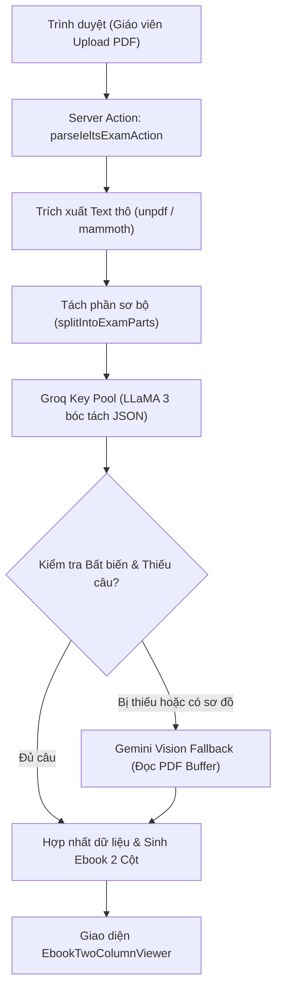

# BÁO CÁO THẨM ĐỊNH KIẾN TRÚC HỆ THỐNG
## MODULE: BÓC TÁCH ĐỀ THI IELTS TỰ ĐỘNG (SMART EXAM PARSER PIPELINE)
**Dự án:** Hệ thống LMS SIMPACE Việt Nam (Đồ án tốt nghiệp MIS)  
**Tài liệu dành cho:** Kiến trúc sư Hệ thống (System Architect) & Hội đồng Kỹ thuật  
**Phiên bản:** 1.1 — Ngày cập nhật: 22/10/2026  

---

## 1. TỔNG QUAN KIẾN TRÚC HIỆN TẠI (AS-IS ARCHITECTURE)

Luồng bóc tách đề thi IELTS hiện tại được thiết kế theo mô hình **Đơn chuỗi Đồng bộ (Synchronous Linear Pipeline)** kích hoạt từ trình duyệt thông qua Server Action của Next.js:



---

## 2. MA TRẬN 10 DẠNG BÀI IELTS: NĂNG LỰC HIỆN TẠI VS THỰC TẾ

| STT | Dạng bài IELTS chuẩn | Tần suất xuất hiện | Khả năng bóc tách hiện tại | Điểm nghẽn kỹ thuật chính |
|:---:|---|:---:|:---:|---|
| 1 | **Multiple Choice (1 đáp án)** | Rất cao | **Tốt (85-90%)** | Thỉnh thoảng bị nuốt các lựa chọn in ngang cùng 1 dòng (vd: `A. red  B. blue`). |
| 2 | **Multiple Choice (Chọn 2/5)** | Trung bình | **Kém (20%)** | Bị nhận diện nhầm thành câu đơn, thiếu cơ chế chấm điểm từng phần (Partial scoring). |
| 3 | **True / False / Not Given (Yes/No/NG)** | Rất cao | **Tốt (90%)** | Đã chuẩn hóa regex nhận diện nhóm chỉ dẫn (Directions). |
| 4 | **Sentence / Notes Completion** | Rất cao | **Khá (75%)** | Dễ bị trôi số thứ tự nếu câu hỏi có định dạng `(1) _______` nằm giữa dòng. |
| 5 | **Table Completion (Bảng thông tin)** | Cao | **Trung bình (40%)** | PDF vector làm vỡ cấu trúc hàng/cột. Text trong các ô bị xáo trộn thứ tự đọc. |
| 6 | **Flow-chart Completion (Sơ đồ quy trình)** | Trung bình | **Rất kém (15%)** | Text nằm trong hình hộp (Vector shapes) bị thư viện PDF bỏ qua hoàn toàn. |
| 7 | **Diagram / Map Labelling (Gắn nhãn sơ đồ)** | Trung bình | **Chưa hỗ trợ (0%)** | Hoàn toàn là hình vẽ bản đồ, text là nhãn tọa độ, Groq text không thể xử lý. |
| 8 | **Matching Headings (Nối tiêu đề đoạn)** | Cao | **Trung bình (50%)** | Đọc được danh sách số La Mã (i–x) nhưng dễ gộp nhầm nội dung tiêu đề vào bài đọc. |
| 9 | **Matching Information / Features** | Trung bình | **Kém (30%)** | Thường bị nhận diện nhầm thành câu hỏi điền từ thay vì dạng ghép cặp đối tượng. |
| 10 | **Summary Completion có khung từ (Word Bank)**| Cao | **Chưa chuẩn (35%)**| Chỉ bóc được chỗ trống, làm mất bảng danh sách từ vựng gợi ý (A, B, C... H) bên dưới. |

---

## 3. CÁC LỖ HỔNG & THIẾU SÓT KIẾN TRÚC CỐT LÕI (CORE DEFICIENCIES)

### Lỗ hổng 1: Nghẽn cổ chai do trích xuất văn bản thuần (Text-Only Extraction Bottleneck)
- **Hiện trạng:** Hệ thống dùng `unpdf` và `pdf-parse` để bóc text dạng chuỗi ký tự (`string`).
- **Hệ quả:** Trong đề thi IELTS (đặc biệt là đề Cambridge bản scan hoặc PDF in ấn), các dạng bài như **Flow-chart, Diagram, Map và Table** được thiết kế dưới dạng vector graphic hoặc hình khối. Thư viện trích xuất chữ thô hoàn toàn bỏ qua hoặc trích xuất chữ lộn xộn không theo trật tự logic, khiến AI (LLaMA 3) nhận được dữ liệu "mù" và bỏ sót hàng loạt câu hỏi (như mất sạch các câu 18–23 trong đề `test2`).

### Lỗ hổng 2: Mô hình Đơn chuỗi Đồng bộ trên môi trường Serverless (Vercel Execution Timeout)
- **Hiện trạng:** Quá trình tải file, convert, gọi nhiều lượt AI Groq và gọi Gemini Vision đều dồn vào **duy nhất 1 Server Action**.
- **Hệ quả:**
  - Đối với đề **Full 40 câu (10–15 trang PDF)**, thời gian xử lý thực tế thường mất **35 – 70 giây**.
  - Serverless Function của Vercel (kể cả đã cấu hình `maxDuration = 60`) rất dễ bị ngắt kết nối (Gateway Timeout 504), đứt gãy giữa chừng hoặc tràn bộ nhớ RAM (1024MB) khi phải buffer file PDF lớn nhiều lần.

### Lỗ hổng 3: Chiến lược phân đoạn (Partitioning Strategy) bị gãy đối với đề 40 câu
- **Hiện trạng:** Hàm `splitIntoExamParts` dùng Regex tĩnh để tìm các từ khóa: `READING PASSAGE 1`, `SECTION 1`, `PART 1`.
- **Hệ quả:**
  - Trong thực tế, nhiều đề thi đặt tiêu đề trong khung viền (Header), ghi chữ cách điệu (`P A S S A G E  1`), hoặc ngắt đoạn không chuẩn.
  - Khi Regex không bắt được mốc phân tách, hệ thống coi toàn bộ 40 câu là 1 phần duy nhất (> 25.000 ký tự). Khi đẩy văn bản này vào Groq AI, AI bị vượt ngưỡng context xử lý câu hỏi, dẫn đến tình trạng **AI bị "hụt hơi", chỉ sinh được 8–15 câu đầu rồi dừng lại**, gây hiện tượng nhảy cóc nghiêm trọng.

### Lỗ hổng 4: Hiệu ứng sụp đổ dây chuyền khi đánh chỉ mục câu hỏi (Cascade Indexing Failure)
- **Hiện trạng:** Code sử dụng thuật toán re-indexing tuần tự:
  ```typescript
  runningQuestionNum = Math.max(runningQuestionNum, num + 1);
  ```
- **Hệ quả (Domino Effect):**
  - Ranh giới chuẩn của đề thi IELTS 40 câu là cố định:
    - **Passage 1:** Câu 1 $\rightarrow$ 13
    - **Passage 2:** Câu 14 $\rightarrow$ 26
    - **Passage 3:** Câu 27 $\rightarrow$ 40
  - Nếu ở Passage 1, AI bị sót mất câu 13 (chỉ trả về 12 câu), thuật toán hiện tại sẽ **đổi câu 14 của Passage 2 thành câu 13**, câu 15 thành câu 14...
  - Toàn bộ 27 câu còn lại của đề thi bị sai lệch số thứ tự so với đề gốc và không thể khớp được với file Excel đáp án của giáo viên.

### Lỗ hổng 5: Thiếu cơ chế Health-check & Đặt sai định danh Model (Model Governance Flaw)
- **Hiện trạng:** Trong `gemini-vision-parser.ts`, code khai báo danh sách model:
  ```typescript
  const GEMINI_MODELS = ["gemini-3.5-flash-lite", "gemini-3.5-flash", "gemini-flash-lite-latest"];
  ```
- **Hệ quả:** Google AI Studio không tồn tại các model phiên bản "3.5". Khi gặp sự cố cần giải cứu sơ đồ, hàm luôn trả về mã lỗi HTTP 404, khiến cơ chế Vision AI bị vô hiệu hóa ngầm mà hệ thống không cảnh báo rõ ràng.

### Lỗ hổng 6: Thiếu cơ chế Tương tác bổ cứu vi mô (Missing Micro Human-in-the-loop)
- **Hiện trạng:** Giáo viên chỉ có thể can thiệp sau khi hệ thống đã bóc tách xong TOÀN BỘ file.
- **Hệ quả:** Khi đề 40 câu bị thiếu sót 1–2 vùng sơ đồ hoặc bảng biểu, giáo viên không có công cụ để khoanh vùng lại trang PDF đó hoặc bấm nút *"Bóc tách lại riêng Passage 2"*, buộc phải sửa tay rất nhiều hoặc bỏ cuộc.

---

## 4. HIỆN TRẠNG NGUỒN LỰC API KEYS & NĂNG LỰC HẠ TẦNG AI (AI RESOURCE INVENTORY)

Dưới đây là bảng thống kê toàn bộ tài nguyên API Key hiện có trong hệ thống để Kiến trúc sư nắm rõ giới hạn định mức (Quota & Limits) nhằm thiết kế cơ chế cân bằng tải:

| Tên định danh biến | Nhà cung cấp | Mô hình phục vụ | Năng lực / Vai trò | Giới hạn miễn phí (Rate Limits) | Hiện trạng trong code |
|---|---|---|---|---|:---:|
| **`GROQ_API_KEY`** | Groq Cloud | `openai/gpt-oss-120b`<br>`qwen/qwen3.8-27b`<br>`openai/gpt-oss-20b` | Key chính: Bóc tách text siêu tốc (~250 tokens/s) | 30 RPM (Req/min)<br>6.000 TPM (Token/min)<br>14.400 RPD (Req/day) | **Đang hoạt động**<br>(Dài 56 ký tự `gsk_...`) |
| **`GROQ_API_KEY_2`** | Groq Cloud | *(Như trên)* | Key dự phòng 1 trong Key Pool (Round-robin + Failover 429) | 30 RPM<br>6.000 TPM<br>14.400 RPD | **Đang hoạt động**<br>(Dài 56 ký tự `gsk_...`) |
| **`GROQ_API_KEY_3`** | Groq Cloud | *(Như trên)* | Key dự phòng 2 trong Key Pool (Round-robin + Failover 429) | 30 RPM<br>6.000 TPM<br>14.400 RPD | **Đang hoạt động**<br>(Dài 56 ký tự `gsk_...`) |
| **`GEMINI_API_KEY`** | Google AI Studio | `gemini-2.0-flash`<br>`gemini-1.5-flash` | Multimodal Vision: "Nhìn" ảnh PDF, bóc Flow-chart, Map, Table | **15 RPM**<br>**1.000.000 TPM**<br>**1.500 RPD** | Cần cập nhật khóa chuẩn `AIzaSy...` & chỉnh tên model |

### Đánh giá của nhóm phát triển về nguồn lực API:
1. **Tổng công suất Groq Key Pool (3 Keys):**
   - Đạt tổng băng thông lý thuyết: **90 RPM** và **~18.000 – 24.000 TPM**.
   - Đủ sức phục vụ cùng lúc **3–4 giáo viên** tải đề thi song song mà không sợ bị nghẽn lỗi HTTP 429.
   - **Hạn chế:** Groq hoàn toàn là Text-LLM, không có khả năng "nhìn" hình vẽ/sơ đồ.
2. **Năng lực Google Gemini Vision:**
   - Hạn mức Token mỗi phút (TPM) cực khủng: **1.000.000 TPM** (gấp 160 lần Groq).
   - Hỗ trợ gửi nguyên trang PDF hoặc ảnh độ phân giải cao để AI đọc trực tiếp bảng biểu và lưu đồ.
   - Hoàn toàn miễn phí, có thể đăng ký bổ sung 2–3 tài khoản để xây dựng **Gemini Key Pool** tương tự như Groq nếu số lượng người dùng tăng cao.

---

## 5. MA TRẬN 3 PHƯƠNG ÁN KIẾN TRÚC ĐỀ XUẤT CHO SYSTEM ARCHITECT

```mermaid
graph TD
    subgraph PA1["Phương án 1: Vision-First Page Pipeline (Khuyến nghị dài hạn)"]
        PDF1["Tệp PDF 40 câu"] --> Render["Render từng trang sang Image (PDF.js)"]
        Render --> V_AI["Gemini 2.0 Flash (Multimodal)"]
        V_AI --> DocStruct["Trích xuất đồng thời: Bài đọc + Sơ đồ + Bảng + Câu hỏi"]
    end

    subgraph PA2["Phương án 2: Anchor-Based Hybrid Pipeline (Khả thi ngay)"]
        PDF2["Tệp PDF 40 câu"] --> Split["Tách trang theo ranh giới Passage (Anchor)"]
        Split --> P1["Passage 1 (Câu 1-13)"]
        Split --> P2["Passage 2 (Câu 14-26)"]
        Split --> P3["Passage 3 (Câu 27-40)"]
        P1 --> FallbackBake["Tự động bù Placeholder [Câu N] nếu AI sót"]
        P2 --> FallbackBake
        P3 --> FallbackBake
    end

    subgraph PA3["Phương án 3: Asynchronous Job Queue & Interactive Crop"]
        PDF3["Tệp PDF 40 câu"] --> Queue["BullMQ / Upstash Redis Queue"]
        Queue --> Worker["Background Worker xử lý từng phần"]
        Worker --> Progress["Server-Sent Events (SSE) cập nhật tiến độ %"]
        Worker --> CropUI["Giáo viên có công cụ Crop khoanh vùng PDF"]
    end
```



### So sánh chi tiết 3 phương án:

| Tiêu chí | Phương án 1: Vision-First Page Pipeline | Phương án 2: Anchor-Based Hybrid (Nhanh nhất) | Phương án 3: Async Queue + Interactive Crop |
|---|---|---|---|
| **Cơ chế cốt lõi** | Biến từng trang PDF thành ảnh, dùng Gemini 2.0 Flash đọc cấu trúc trực quan. | Dùng Pool 3 Keys Groq cho Text + Gemini 2.0 Flash giải cứu sơ đồ + Neo cứng 1-13, 14-26, 27-40. | Xử lý hàng đợi nền bất đồng bộ, có tính năng kéo thả khoanh vùng trên PDF. |
| **Độ chính xác đề 40 câu**| **Cực cao (92 - 96%)**, đọc được mọi sơ đồ, bảng biểu, map. | **Khá cao (80 - 85%)**, khắc phục triệt để lỗi nhảy cóc số câu. | **Tuyệt đối (98%)** nhờ sự kết hợp giữa Queue và can thiệp thủ công. |
| **Độ trễ xử lý** | 15 – 25 giây (gọi song song theo trang). | 8 – 15 giây (siêu tốc nhờ Groq). | Xử lý ngầm, giao diện nhận tiến trình theo %. |
| **Khả năng deploy Vercel**| Rất tốt nếu gọi qua Serverless Function có streaming. | Cực kỳ tương thích, không lo timeout. | Cần thêm hạ tầng Redis (Upstash) hoặc Worker riêng. |
| **Độ phức tạp triển khai** | Trung bình (2–3 ngày). | **Thấp (1 ngày - Khả thi ngay lập tức)**. | Cao (5–7 ngày). |

---

## 6. ĐỀ XUẤT HÀNH ĐỘNG CỤ THỂ (RECOMMENDED ACTION PLAN)

Để đồ án tốt nghiệp đạt chuẩn chất lượng kỹ thuật cao nhất và demo hoàn hảo với hội đồng:

1. **Giai đoạn tức thì (Khắc phục ngay trong hôm nay - Áp dụng Phương án 2):**
   - **Sửa Model Gemini:** Đổi tên model sang `gemini-2.0-flash` và cập nhật API key chuẩn `AIzaSy...`.
   - **Áp dụng Hard Anchor Rules:** Cố định ranh giới cho đề 40 câu:
     - Passage 1/Section 1: Bắt buộc neo khoảng câu 1–13 (hoặc 1–10).
     - Passage 2/Section 2: Bắt buộc neo khoảng câu 14–26 (hoặc 11–20).
     - Passage 3/Section 3: Bắt buộc neo khoảng câu 27–40 (hoặc 21–30).
   - **Cơ chế Bù Khuyết Tự Động (Auto-Infill):** Nếu AI trả về thiếu câu nào trong dải số, hệ thống tự động sinh câu hỏi mẫu với nhãn `[Câu X - Giáo viên cần bổ sung đề bài]` để giữ vững nguyên tắc bất biến không làm xô lệch toàn bộ đề thi.
   - **Bổ sung các nút công cụ:** Đưa các nút `+ Nối tiêu đề`, `+ Tóm tắt`, `+ Bảng biểu` lên giao diện Cột 2.

2. **Giai đoạn nâng cao (Nếu Kiến trúc sư đồng ý mở rộng):**
   - Chuyển hẳn sang **Phương án 1 (Vision-First)** kết hợp trích xuất ảnh PDF để bóc tách được cả các bài Map Labelling và sơ đồ máy móc phức tạp nhất của đề thi Cambridge.
