# BÁO CÁO THẨM ĐỊNH KIẾN TRÚC & ĐỀ XUẤT GIẢI PHÁP KỸ THUẬT
## MODULE: BÓC TÁCH ĐỀ THI IELTS TỰ ĐỘNG SANG EBOOK 2 CỘT TƯƠNG TÁC
**Dự án:** Hệ thống Quản lý Học tập LMS — Công ty Cổ phần SIMPACE Việt Nam  
**Phân loại:** Đồ án Tốt nghiệp Chuyên ngành Hệ thống Thông tin Quản lý (MIS)  
**Tài liệu trình duyệt:** Kiến trúc sư Hệ thống (System Architect) & Giảng viên Hướng dẫn  
**Tài liệu đính kèm:** Mã nguồn tham khảo `PaddleOCR-main.zip` (Baidu PP-Structure V2)  
**Phiên bản:** Final Proposal — Ngày lập: 22/10/2026  

---

## 1. BỐI CẢNH DỰ ÁN & RÀNG BUỘC NGUỒN LỰC THỰC TẾ (RESOURCE CONSTRAINTS)

Để đưa ra phương án khả thi, nhóm phát triển xin công khai minh bạch toàn bộ hiện trạng năng lực kỹ thuật và giới hạn tài nguyên của dự án:

| Hạng mục | Hiện trạng thực tế | Giới hạn kỹ thuật & Ràng buộc cứng |
|---|---|---|
| **Đội ngũ phát triển** | Nhóm 3 sinh viên năm cuối ngành MIS | Vừa nghiên cứu vừa lập trình; không có kỹ sư AI/ML chuyên sâu. |
| **Tiến độ triển khai** | Mô hình Agile Scrum, chu kỳ **1 tháng** | Ưu tiên giải pháp tích hợp nhanh, ổn định, dễ bàn giao và bảo trì. |
| **Ngân sách dự án** | **0 VNĐ (Hoàn toàn dùng Free Tier)** | Tuyệt đối **không có ngân sách** thuê Cloud Server riêng (VPS có GPU) hoặc mua gói API trả phí của OpenAI/Anthropic. |
| **Hạ tầng Production** | **Next.js 14 App Router trên Vercel (Hobby Free)** | • Thời gian thực thi Serverless Function tối đa: **60 giây**. • Bộ nhớ RAM mỗi Lambda instance: **1024 MB**. • Dung lượng gói triển khai (Bundle Size): **Tối đa 50 MB - 250 MB**. • Không hỗ trợ chạy nền ngầm (Daemon/Background Worker vĩnh viễn). |
| **Cơ sở dữ liệu** | **PostgreSQL trên Supabase (Free Tier)** | 500 MB lưu trữ, kết nối qua Transaction Pooler Supavisor (Port 6543). |
| **Nguồn lực AI: Groq Cloud** | **Pool 3 API Keys miễn phí** (`gsk_...`) | • Model: `openai/gpt-oss-120b`, `qwen/qwen3.8-27b`, `openai/gpt-oss-20b`. • Tổng băng thông lý thuyết: **90 RPM** và **~24.000 TPM**. • Ưu điểm: Suy luận siêu tốc (~250 tokens/giây), có sẵn cơ chế Round-robin & Failover. • **Hạn chế:** Thuần Text (Text-only), hoàn toàn "mù" với hình ảnh/sơ đồ vector. |
| **Nguồn lực AI: Google Gemini** | **1 Khóa Google AI Studio (Free Tier)** | • Model: `gemini-2.0-flash` & `gemini-1.5-flash`. • Hạn mức: **15 RPM**, **1.000.000 TPM**, **1.500 requests/ngày**. • Ưu điểm: Đa phương thức (Multimodal), "nhìn" trực tiếp ảnh trang PDF/sơ đồ/bảng biểu. |
| **Nguồn lực OCR ngoài** | **1 Khóa OCR.space miễn phí** (`K85780797588957`) | 500 requests/ngày, giới hạn file $\le 1$MB. Chỉ bóc chữ thô phẳng, không hiểu ngữ cảnh. |
| **Thư viện OCR nội bộ** | **Tesseract.js & PDF.js Offline** (`public/vendor/`) | Đã đóng gói cục bộ, chạy trên trình duyệt client, không tốn tài nguyên server. |

---

## 2. PHÂN TÍCH KIẾN TRÚC HIỆN TẠI & NGUYÊN NHÂN GÂY LỖI TRÊN ĐỀ 40 CÂU

### 2.1. Luồng xử lý hiện tại (As-Is Pipeline)
1. Giáo viên tải PDF lên trình duyệt $\rightarrow$ Gửi về Server Action `parseIeltsExamAction`.
2. Dùng `unpdf` bóc chuỗi ký tự thô $\rightarrow$ Dùng Regex `splitIntoExamParts` chia thành các Part.
3. Gửi văn bản từng Part cho Groq AI (LLaMA 3) bóc tách JSON.
4. Nếu phát hiện thiếu câu, gọi hàm fallback `extractDiagramQuestionsWithGemini` để đọc PDF buffer.
5. Sắp xếp lại số thứ tự câu hỏi và hiển thị lên giao diện Ebook 2 Cột.

### 2.2. Điểm nghẽn kỹ thuật cốt lõi (Gốc rễ sự cố)
1. **Nghẽn trích xuất chữ thuần (Text-only Blindness):**
   Trong các đề thi IELTS chuẩn (như bộ đề Cambridge), các dạng câu hỏi **Flow-chart (Sơ đồ quy trình), Table (Bảng phân loại), Map Labelling (Bản đồ)** được vẽ bằng hình khối vector. Thư viện text thông thường bỏ qua hoàn toàn chữ nằm trong khối hình này, khiến Groq không hề nhận được dữ liệu đề bài.
2. **Hiệu ứng sụp đổ dây chuyền khi đánh chỉ mục (Domino Indexing Failure):**
   Đề 40 câu có ranh giới chuẩn: Passage 1 (1–13), Passage 2 (14–26), Passage 3 (27–40). Hiện tại code đang cộng dồn số thứ tự:
   $$\text{runningQuestionNum} = \max(\text{runningQuestionNum}, \text{num} + 1)$$
   Khi Passage 1 bị AI đọc sót mất 1 câu (chỉ ra 12 câu), thuật toán tự động đổi câu 14 của Passage 2 thành câu 13! Việc này làm **toàn bộ 27 câu phía sau bị lệch số thứ tự 1 bậc**, dẫn đến gãy khớp nối khi giáo viên nạp file Excel đáp án.
3. **Lỗ hổng cấu hình gọi Gemini:**
   Hàm fallback trong code đang khai báo model `gemini-3.5-flash-lite` (tên không tồn tại trong Google API, bị lỗi HTTP 404), đồng thời trên Vercel chưa cấu hình đồng bộ biến môi trường `GEMINI_API_KEY`.

---

## 3. ĐÁNH GIÁ CHUYÊN SÂU MÃ NGUỒN `PaddleOCR-main.zip` (PP-STRUCTURE V2)

Nhóm đã mổ xẻ gói mã nguồn `PaddleOCR-main.zip` (2.969 files, trọng tâm là module `ppstructure/`). Dưới đây là kết luận kỹ thuật trung thực:

### 3.1. Những tư tưởng kiến trúc xuất sắc đáng học hỏi:
- **Tư tưởng Phân tích Bố cục (Layout Analysis - PicoDet):** PaddleOCR không đọc cả trang tài liệu cùng lúc, mà dùng mô hình thị giác phân rã trang giấy thành các khối riêng biệt:
  $$\text{Trang PDF} \xrightarrow{\text{PicoDet}} \{\text{Khối Bài đọc}\} \cup \{\text{Khối Bảng Table}\} \cup \{\text{Khối Sơ đồ Figure}\} \cup \{\text{Khối Tiêu đề}\}$$
- **Nhận diện Bảng có cấu trúc (Table Recognition - SLANet):** Nhận diện trực tiếp thẻ HTML `<tr>`, `<td>`, khôi phục nguyên trạng hàng và cột sang Markdown/Excel thay vì để text bị dính liền.
- **Loại bỏ Header/Footer tự động:** Lọc sạch số trang và tên sách gây nhiễu trước khi phân tích câu hỏi.

### 3.2. Tính khả thi thực tế: Có nhúng trực tiếp PaddleOCR vào dự án được không?
👉 **KẾT LUẬN: HOÀN TOÀN BẤT KHẢ THI trong khuôn khổ hệ thống hiện tại.**
- **Rào cản Runtime:** Dự án chạy **Next.js (Node.js)**, trong khi PaddleOCR chạy trên nền **Python và framework PaddlePaddle** (Baidu).
- **Rào cản Dung lượng (Bundle Size):** Bộ thư viện Python + các file trọng số AI của PP-Structure nặng từ **800 MB đến hơn 1.5 GB**. Vercel Serverless Function chỉ cho phép tối đa 50 MB (giải nén 250 MB). Đưa PaddleOCR lên Vercel chắc chắn gây lỗi vượt dung lượng triển khai.
- **Rào cản Phần cứng:** PaddleOCR cần GPU (CUDA) hoặc CPU rất mạnh. Trên Serverless miễn phí, việc load model 1.5 GB vào RAM sẽ gây tràn bộ nhớ (Out-Of-Memory) hoặc quá thời gian khởi động (Cold Start 30–45s).
- **Chi phí nếu muốn dùng:** Nhóm phải thuê riêng một máy chủ VPS Linux có GPU (chi phí khoảng $30 – $50/tháng) và dựng FastAPI gateway. Điều này vi phạm ràng buộc ngân sách 0 VNĐ của đồ án.

---

## 4. MA TRẬN 3 PHƯƠNG ÁN KIẾN TRÚC TRÌNH KIẾN TRÚC SƯ HỆ THỐNG

Dựa trên việc học hỏi tư tưởng của PaddleOCR nhưng tôn trọng triệt để ràng buộc nguồn lực Vercel/Miễn phí, nhóm xin đề xuất 3 phương án:

```mermaid
graph TD
    subgraph PA2["Phương án 2: Hard-Anchor Hybrid Pipeline (Khuyến nghị số 1 cho Đồ án)"]
        PDF2["PDF Đề thi 40 câu"] --> Split2["Tách 3 Passages theo ranh giới cứng: [1-13], [14-26], [27-40]"]
        Split2 --> GroqP1["Passage 1 (Groq Key 1)"]
        Split2 --> GroqP2["Passage 2 (Groq Key 2)"]
        Split2 --> GroqP3["Passage 3 (Groq Key 3)"]
        GroqP1 --> Merge2["Hợp nhất & Kiểm tra khuyết thiếu"]
        GroqP2 --> Merge2
        GroqP3 --> Merge2
        Merge2 --> Infill["Cơ chế Auto-Infill: Bù ô giữ chỗ [Câu X] nếu AI sót"]
        Infill --> HITL["Giáo viên duyệt trên Ebook 2 Cột (Human-in-the-loop)"]
    end

    subgraph PA1["Phương án 1: Serverless Vision-First Pipeline"]
        PDF1["PDF Đề thi 40 câu"] --> Canvas["Client PDF.js render từng trang ra Ảnh"]
        Canvas --> GeminiVision["Gemini 2.0 Flash (Multimodal) đóng vai trò PP-Structure trên Cloud"]
        GeminiVision --> DirectJSON["Trích xuất trực tiếp: Bảng + Sơ đồ + Bài đọc sang JSON"]
    end

    subgraph PA3["Phương án 3: Microservice Backend riêng (Dùng nguyên bản PaddleOCR)"]
        PDF3["PDF Đề thi 40 câu"] --> FastAPI["Máy chủ VPS Python riêng (FastAPI)"]
        FastAPI --> FullPaddle["PP-Structure V2 chạy trực tiếp"]
        FullPaddle --> NextJS["Gửi kết quả JSON về Next.js"]
    end
```

### So sánh ma trận kỹ thuật 3 phương án:

| Tiêu chí so sánh | Phương án 1: Serverless Vision-First | Phương án 2: Hard-Anchor Hybrid (Đề xuất) | Phương án 3: Dựng Backend PaddleOCR riêng |
|---|---|---|---|
| **Công nghệ cốt lõi** | PDF.js + Gemini 2.0 Flash Multimodal. | Groq Pool 3 Keys + Hard Anchor + Auto-Infill + Gemini fallback. | Python FastAPI + PaddleOCR (PP-Structure). |
| **Độ chính xác đề 40 câu**| **Rất cao (90 – 95%)**, nhận diện được cả hình vẽ và bảng biểu. | **85 – 90%**, câu hỏi không bao giờ bị nhảy cóc; bù khuyết trong 1 phút. | **92 – 96%** theo chuẩn học thuật Baidu. |
| **Thời gian xử lý** | 15 – 25 giây. | **8 – 15 giây (siêu tốc)**. | 20 – 40 giây (tùy cấu hình CPU/GPU của VPS). |
| **Tương thích Vercel Free**| Hoàn toàn tương thích (100% Serverless). | **Cực kỳ tối ưu, 0 rủi ro timeout**. | Phụ thuộc máy chủ ngoài. |
| **Chi phí hạ tầng** | **0 VNĐ (Miễn phí 100%)**. | **0 VNĐ (Miễn phí 100%)**. | **Tốn phí duy trì VPS hàng tháng ($30 - $50)**. |
| **Thời gian thực hiện** | 2 – 3 ngày. | **1 ngày (Khả thi bàn giao ngay)**. | 5 – 7 ngày (phức tạp hạ tầng). |

---

## 5. CÁC CÂU HỎI QUYẾT ĐỊNH CẦN KIẾN TRÚC SƯ HỆ THỐNG TƯ VẤN

Để nhóm hoàn thiện hệ thống một cách chuẩn mực nhất, kính mong Kiến trúc sư cho ý kiến định hướng về **3 câu hỏi sau**:

1. **Về chiến lược bóc tách:** Kiến trúc sư có đồng thuận với **Phương án 2 (Hard-Anchor Hybrid + Human-in-the-loop)** không?  
   *(Triết lý: AI đảm nhận 80% tác vụ trích xuất tự động; 20% các câu hỏi sơ đồ khó được hệ thống giữ chỗ số câu để giáo viên hoàn thiện trên giao diện Ebook 2 cột trong 1–2 phút).*
2. **Về xử lý hình ảnh sơ đồ/bảng biểu:** Với hạ tầng 0 VNĐ hiện tại, Kiến trúc sư có khuyến nghị thay thế toàn bộ OCR thô bằng việc gọi **Gemini 2.0 Flash (Multimodal)** đóng vai trò như một "PP-Structure trên đám mây" hay không?
3. **Về kiến trúc dữ liệu Ebook 2 Cột:** Để hỗ trợ toàn diện các dạng bài IELTS khó (Matching Headings, Table, Flowchart, Summary có Word Bank), cấu trúc lưu trữ JSON hiện tại trong bảng `Assignment` đã tối ưu chưa, hay cần chuẩn hóa thêm trường dữ liệu nào?

---
*Tài liệu được lập bởi Nhóm Sinh viên Đồ án LMS SIMPACE — Khoa Hệ thống Thông tin Quản lý (MIS).*
