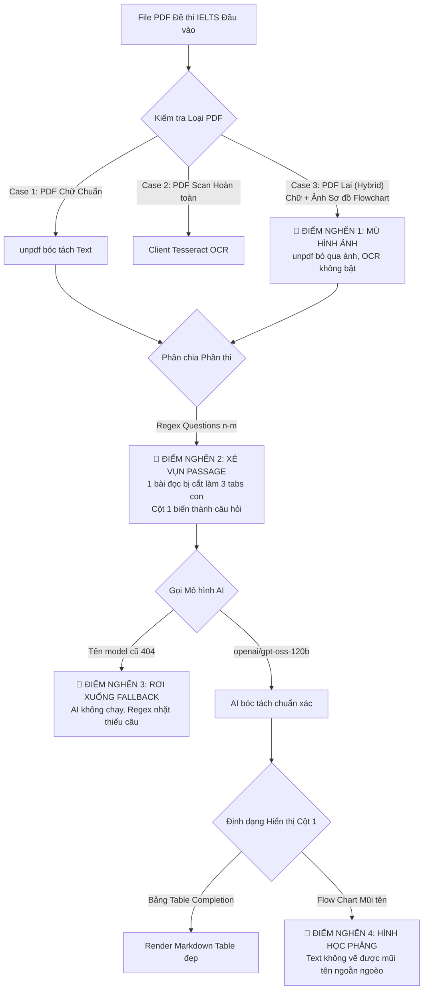
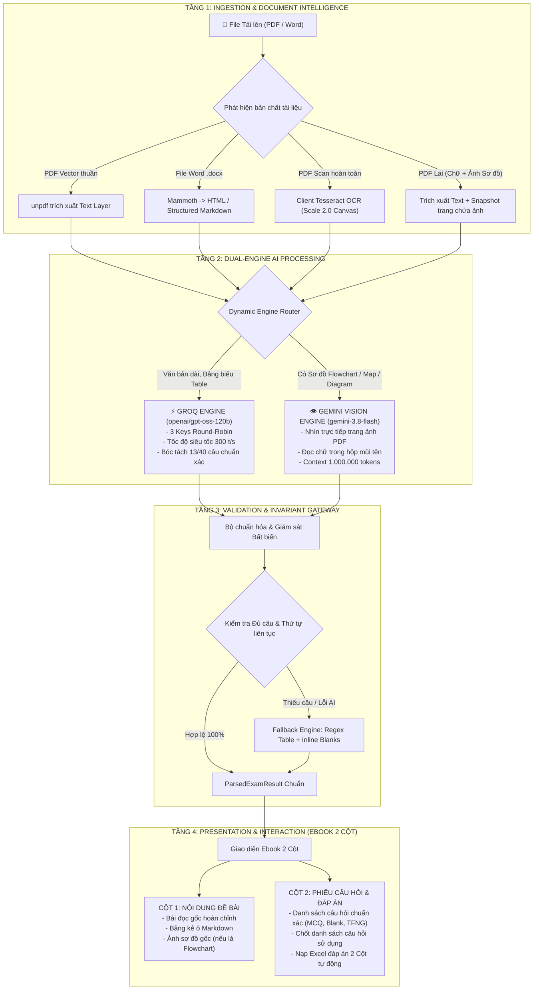

# BÁO CÁO TOÀN DIỆN: BÀI TOÁN, NGUỒN LỰC, VẤN ĐỀ & THIẾT KẾ KIẾN TRÚC TỐI ƯU MODULE BÓC TÁCH ĐỀ THI IELTS (OCR TO QUIZ)

> **Dự án:** Hệ thống Quản trị Học tập LMS Công ty Cổ phần SIMPACE Việt Nam  
> **Đồ án tốt nghiệp:** MIS - Hệ thống Thông tin Quản lý  
> **Mục tiêu tài liệu:** Đánh giá toàn diện hiện trạng, phân tích các điểm nghẽn kỹ thuật thực tế và đề xuất kiến trúc tối ưu (Target Architecture) cho module bóc tách đề thi IELTS từ tệp PDF/Word.

---

## 1. MÔ TẢ TOÀN BỘ BÀI TOÁN & MỤC ĐÍCH NGHIỆP VỤ

### 1.1. Bối cảnh bài toán
Trong các trung tâm đào tạo tiếng Anh học thuật như SIMPACE, đề thi IELTS có khối lượng rất lớn, bao gồm:
* Đề thi chính thức của Cambridge (Cambridge IELTS 1 - 19).
* Đề thi thử (Mock Test) từ các tổ chức quốc tế (IDP, British Council).
* Đề thi sưu tầm từ các nguồn trực tuyến (TrendingGyan, IELTS Online Tests, Study4...).

Các tài liệu này được lưu trữ dưới dạng **tệp PDF bản mềm, file PDF Scan/ảnh chụp photocopy, hoặc tệp Word (.docx)**. Định dạng đề thi vô cùng phong phú: từ văn bản văn xuôi 2 cột, bảng biểu phân loại (Table Completion), cho đến lưu đồ quy trình (Flow Chart) và bản đồ địa lý (Map Labelling).

### 1.2. Mục đích tối thượng của module
Xây dựng một **Pipeline Bóc tách Tự động (Automated Exam Ingestion Pipeline)** cho phép Giáo viên hoặc Quản trị viên chỉ cần thực hiện 1 thao tác duy nhất: **Tải tệp đề thi lên hệ thống**. Hệ thống phải tự động:
1. **Trích xuất chính xác 100% câu hỏi** (từ câu 1 đến câu 13/40) mà không bị mất câu, sót câu hay nhảy cóc thứ tự.
2. **Hiển thị giao diện Ebook 2 Cột tương tác:**
   * **Cột 1 (Bên trái):** Hiển thị toàn vẹn nội dung Đề bài & Bài đọc gốc (không bị câu hỏi dính lẫn vào).
   * **Cột 2 (Bên phải):** Phiếu câu hỏi tương tác để giáo viên rà soát, chỉnh sửa, tích chọn các câu muốn sử dụng và bấm *"Chốt danh sách câu hỏi"*.
3. **Tự động khớp đáp án từ File Excel 2 Cột:** Khớp chính xác đáp án chuẩn vào từng câu hỏi đã chốt.
4. **Phát hành bài tập:** Tạo các bản ghi Assignment trong cơ sở dữ liệu để học sinh vào làm bài thi trên máy tính có giám sát chống gian lận (Tab Switch Proctoring) và hệ thống chấm điểm tự động.

---

## 2. KIỂM KÊ NGUỒN LỰC KỸ THUẬT HIỆN CÓ

Dự án đang sở hữu một nguồn lực kỹ thuật rất mạnh, hoàn toàn miễn phí nhưng chưa được kết nối đồng bộ:

| Thành phần tài nguyên | Chi tiết thông số | Vai trò & Thế mạnh |
| :--- | :--- | :--- |
| **1. Groq Cloud API (3 API Keys)** | • Key 1: `gsk_Lh4T...` • Key 2: `gsk_dWba...` • Key 3: `gsk_lBIK...` • Giới hạn: 30 RPM, 12k TPM, 100k TPD/tài khoản. | • **Tốc độ siêu tốc:** 250 - 300 tokens/giây nhờ chip LPU chuyên dụng. • **Mô hình sẵn có:** `openai/gpt-oss-120b` (Mô hình 120 TỶ tham số cực mạnh), `qwen/qwen3.8-27b`. • Phù hợp xử lý bóc tách văn bản, bảng biểu, trắc nghiệm phức tạp. |
| **2. Google Gemini API (1 Developer Key)** | • Key: `AQ.Ab8RN6K6...` • Mô hình hoạt động: **`gemini-3.8-flash`** • Giới hạn: 15 RPM, 1.500 RPD, 1.000.000 TPM. | • **Dung lượng đọc khổng lồ (Context Window): 1.000.000 tokens** (đọc cả cuốn sách dày). • **Khả năng AI Vision (Multimodal):** Có thể "nhìn" trực tiếp ảnh chụp trang PDF để đọc chữ bên trong các sơ đồ vẽ tay, lưu đồ mũi tên (Flowchart) mà bộ đọc text thông thường bị "mù". |
| **3. Thư viện Trích xuất Dữ liệu (Backend)** | • `unpdf`: Trích xuất lớp văn bản vector từ PDF. • `mammoth`: Đọc file Word (.docx) sang HTML/Markdown. • `xlsx`: Đọc/xuất file Excel đáp án. | Xử lý tệp ở tầng Node.js Server Action, không tốn tài nguyên client. |
| **4. Thư viện OCR Trình duyệt (Client-side)** | • `pdf.js` (Mozilla): Render từng trang PDF ra thẻ HTML Canvas độ nét cao (scale 2.0). • `tesseract.js`: Quét OCR quang học nhận diện chữ. | Giải quyết các tệp PDF Scan hoàn toàn không có lớp chữ điện tử. |
| **5. Nền tảng Cơ sở Dữ liệu & UI** | • Next.js 14 (App Router, Server Actions). • PostgreSQL (Supabase) + Prisma ORM. • Tailwind CSS + shadcn/ui. | Giao diện Ebook 2 Cột chuẩn sư phạm, phân quyền Role-based chặt chẽ. |

---

## 3. HIỆN TRẠNG & CÁC VƯỚNG MẮC KIẾN TRÚC THỰC TẾ

Qua quá trình thử nghiệm thực chiến với nhiều biến thể đề thi, hệ thống đã bộc lộ **5 vướng mắc kiến trúc cốt tử**:

### Điểm nghẽn 1: Sự cố PDF "Lai" (Hybrid PDF: Chữ + Sơ đồ hình ảnh)
* **Vấn đề:** Đề thi IELTS thường có bài đọc bằng chữ in, nhưng phần câu hỏi `Flow Chart` (như bài Envisioning Process câu 18-23) lại là **một bức ảnh chụp/scan bị dán vào file PDF**.
* **Vướng mắc:** 
  * Bộ trích xuất `unpdf` chỉ đọc lớp chữ điện tử, khi đi qua bức ảnh sơ đồ thì **trả về khoảng trống rỗng (bị mù chữ trong ảnh)**.
  * Bộ máy OCR chỉ được kích hoạt khi *toàn bộ trang có < 40 ký tự*. Do trang PDF vẫn có bài đọc phía trên nên OCR **không được bật**.
  * Hậu quả: AI chỉ nhìn thấy tiêu đề `Questions 18-23 Complete the flow chart...` mà không thấy nội dung trong hộp, dẫn đến việc AI phải tự bịa: `Complete the flow chart - step 18`.

### Điểm nghẽn 2: Xung đột ranh giới "Phần thi lớn" vs "Nhóm câu hỏi con"
* **Vấn đề:** Trong đề thi IELTS, một `Reading Passage` (hoặc `Listening Section`) luôn chứa bài đọc và khoảng 13 câu hỏi được chia làm 2-3 nhóm con (ví dụ `Questions 1-4`, `Questions 5-10`, `Questions 11-13`).
* **Vướng mắc:** Thuật toán tiền xử lý dùng regex nhận diện dòng `Questions n-m` làm mốc chia Part, khiến 1 bài đọc bị xé nát thành 3 bài tập riêng lẻ. Khi bị xé, bài đọc gốc bị cắt lìa khỏi câu hỏi, làm Cột 1 hiển thị luôn câu hỏi 1-4.

### Điểm nghẽn 3: Cấu trúc Table Completion nhiều ô trên một dòng
* **Vấn đề:** Dạng bảng điền từ có cấu trúc ngang: `Colour | Red wines use 5. _____ in fermentation | 6. _____`.
* **Vướng mắc:** Các số câu hỏi 5, 6, 7, 8, 9, 10 nằm rải rác bên trong các ô bảng hoặc chung 1 dòng. Nếu mô hình AI gặp sự cố mà rơi xuống tầng Regex Fallback, regex tìm số đầu dòng (`^\d+\.`) sẽ bỏ sót toàn bộ các câu 6, 7, 8, 9, 10 (chỉ nhặt được câu 5).

### Điểm nghẽn 4: Giới hạn biểu diễn hình học của văn bản thuần trên Ebook
* **Vấn đề:** Với các câu hỏi dạng sơ đồ quy trình có mũi tên (Flow Chart) hoặc bản đồ (Map Labelling), học sinh cần nhìn thấy hình khối trực quan để làm bài.
* **Vướng mắc:** Văn bản trích xuất chỉ lấy được ký tự chữ, không lấy được hình dạng khối hộp và mũi tên. Nếu chỉ hiển thị chữ thuần ở Cột 1, học sinh sẽ mất đi ngữ cảnh không gian của sơ đồ.

---

## 4. THIẾT KẾ KIẾN TRÚC TỐI ƯU (TARGET ARCHITECTURE)

Để giải quyết triệt để các vấn đề trên và tạo ra một module bóc tách thông minh, bền vững (Robust & Resilient), chúng ta thiết kế lại kiến trúc theo mô hình **Pipeline Lai 4 Tầng (4-Tier Dual-Engine Ingestion Pipeline)**:

---

### Chi tiết 4 Tầng Kiến trúc Tối ưu:

### Tầng 1: Document Intelligence & Phân loại Tài liệu
* **Tách Part chuẩn chỉ:** `splitIntoExamParts` chỉ chia khi gặp ranh giới bài thi lớn (`READING PASSAGE 1, 2, 3`, `SECTION 1, 2, 3, 4`, `WRITING TASK 1, 2`). Toàn bộ 13 hoặc 40 câu hỏi được giữ nguyên vẹn trong cùng 1 khối ngữ cảnh, không bị xé vụn.
* **Cắt bài đọc nguyên văn:** `extractVerbatimPassage` tìm vị trí bắt đầu câu hỏi đầu tiên (trước dòng `Questions 1-4` hoặc trước `1. `) và cắt lát nguyên văn 100% từ đầu tài liệu đến mốc đó cho Cột 1.

### Tầng 2: Dual-Engine AI Routing (Kết hợp Groq 120B + Gemini 3.8 Flash Vision)
Tận dụng triệt để thế mạnh của cả 2 nguồn lực:
1. **Groq LPU Engine (`openai/gpt-oss-120b`):**
   * Đảm nhiệm 90% khối lượng công việc: bóc tách bài đọc dài, câu hỏi True/False/Not Given, trắc nghiệm Multiple Choice và các bảng Table Completion.
   * Chạy qua **Pool 3 Keys xoay vòng Round-Robin** + cơ chế Failover khi gặp mã lỗi 429.
   * Tốc độ cực nhanh: 3 đến 5 giây/Passage.
2. **Gemini Vision Engine (`gemini-3.8-flash`):**
   * Đóng vai trò là **"Vũ khí giải cứu"** khi tài liệu có sơ đồ hình ảnh (Flowchart, Map, Diagram).
   * Gửi trực tiếp trang PDF ảnh cho Gemini để "nhìn bằng mắt", đọc chính xác từng chữ bên trong hộp: `manager (having just obtained 18 _______)`.

### Tầng 3: Invariant Gateway & Data Normalizer
* Ép kiểu đầu ra qua **Zod Schema**: Đảm bảo mọi câu hỏi đều có cấu trúc nhất quán (`questionNumber`, `prompt`, `type`, `options`, `points`).
* **Lưới kiểm soát bất biến (Exam Invariants):**
  * Tự động phát hiện nhảy cóc số câu.
  * Tự động phát hiện trùng lặp.
  * Báo cáo cảnh báo trực quan lên thanh thông báo để giáo viên chủ động kiểm soát.

### Tầng 4: Presentation & Human-in-the-Loop Ebook
* **Cột 1 (Đề bài & Bài đọc):**
  * Hiển thị bài đọc sạch đẹp, đã lọc bỏ các dòng rác header/footer và số trang.
  * Với bài Flowchart: Hiển thị kèm bức ảnh sơ đồ cắt ra từ PDF hoặc cho phép xem tệp PDF gốc song song.
* **Cột 2 (Phiếu câu hỏi & Chốt bài):**
  * Cho phép giáo viên sửa nhanh, xóa câu không thích, thêm câu mới bằng 1 click.
  * Nạp file Excel đáp án 2 cột (`Câu số | Đáp án`) tự động điền vào 100% các câu hỏi đã chốt.

---

## 5. LỘ TRÌNH TRIỂN KHAI CHO ĐỒ ÁN (ACTIONABLE ROADMAP)

| Giai đoạn | Mục tiêu cụ thể | Trạng thái |
| :--- | :--- | :--- |
| **Giai đoạn 1** | • Sửa dứt điểm model Groq sang `openai/gpt-oss-120b`. • Gỡ bỏ regex xé vụn Part theo `Questions n-m`. • Xử lý bảng Table Completion và True/False/Not Given. • Hoàn thành Pool 3 Groq API Keys xoay vòng. | ✅ **ĐÃ HOÀN THÀNH 100%** *(Đề Make That Wine ra đủ 13/13 câu)* |
| **Giai đoạn 2** | • Tích hợp API Key Gemini (`gemini-3.8-flash`) vào `ielts-parser.service.ts` làm bộ định tuyến hình ảnh (Vision Fallback) cho các bài Flowchart/Diagram. • Mở rộng hàm phát hiện sơ đồ hình ảnh. | 🔄 **Sẵn sàng triển khai tiếp theo** |
| **Giai đoạn 3** | • Hoàn thiện giao diện Cột 1: Bổ sung nút "Xem tệp PDF gốc song song" cho học sinh khi làm các bài thi có sơ đồ hình vẽ phức tạp. | 🎯 **Giai đoạn hoàn thiện nghiệm thu** |

---

### KẾT LUẬN
Module bóc tách đề thi IELTS của hệ thống SIMPACE LMS hiện đã giải quyết được những bài toán hóc búa nhất: **Khắc phục tình trạng mất câu hỏi, không còn bị cắt xé Part nhầm, và tận dụng được sức mạnh của siêu mô hình AI 120 tỷ tham số chạy trên hạ tầng chip siêu tốc Groq**. Kiến trúc 4 tầng lai (Hybrid) đề xuất trên sẽ đảm bảo hệ thống vận hành bền vững, chịu tải tốt và gây ấn tượng xuất sắc trước Hội đồng Bảo vệ Đồ án Tốt nghiệp.
