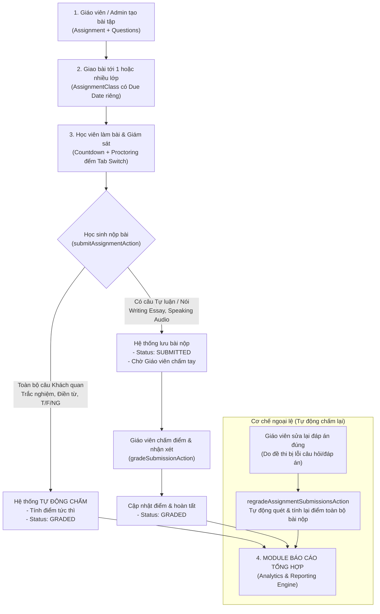
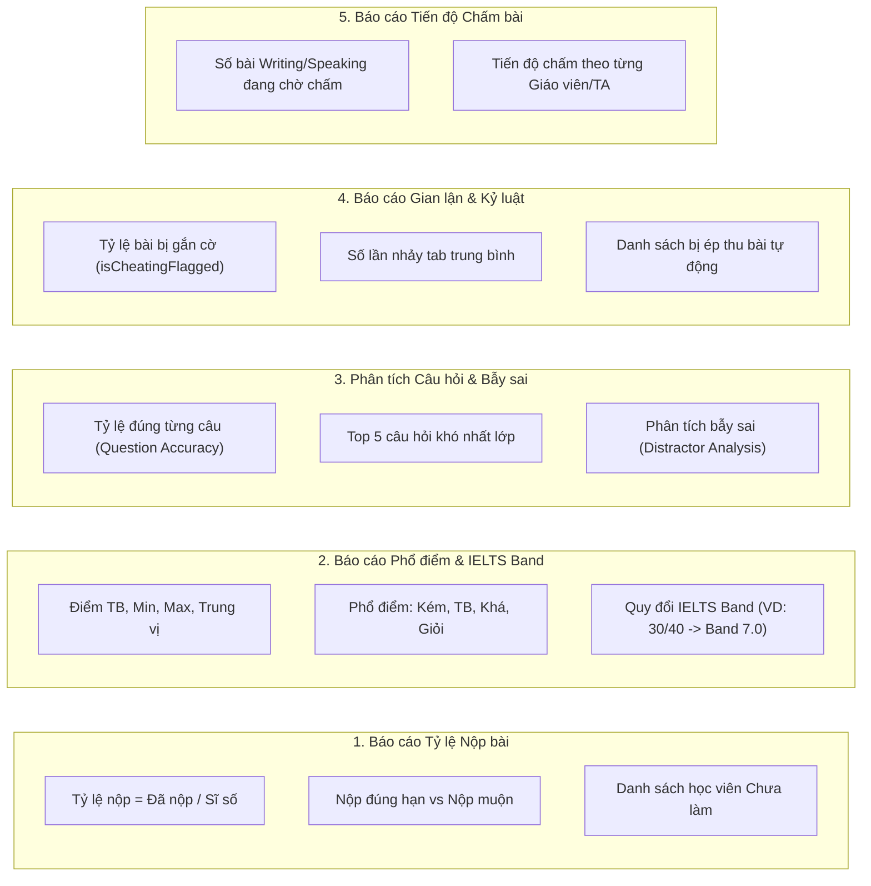

# TÀI LIỆU ĐẶC TẢ LUỒNG BÀI TẬP, CƠ CHẾ CHẤM ĐIỂM & ĐẶC TẢ MODULE BÁO CÁO
**Dự án: Hệ thống LMS Công ty Cổ phần SIMPACE Việt Nam (KLTN MIS 2026)**

> **Mục đích tài liệu:** Cung cấp thông tin chi tiết về mô hình dữ liệu, phân loại bài tập, thuật toán chấm điểm và khung chỉ số phân tích dữ liệu phục vụ trực tiếp cho việc xây dựng **Module Báo Cáo (Reporting & Analytics Module)**.

---

## 1. TỔNG QUAN KIẾN TRÚC LUỒNG BÀI TẬP & CHẤM ĐIỂM



---

## 2. KIẾN TRÚC CƠ SỞ DỮ LIỆU THỰC TẾ (`prisma/schema.prisma`)

### 2.1. Các Enum danh mục

```prisma
enum AssignmentSkill {
  READING       // Kỹ năng Đọc
  LISTENING     // Kỹ năng Nghe
  WRITING       // Kỹ năng Viết
  SPEAKING      // Kỹ năng Nói
}

enum AssignmentType {
  HOMEWORK      // Bài tập về nhà
  QUIZ          // Bài kiểm tra ngắn trên lớp
  MIDTERM       // Thi giữa kỳ
  MOCK_EXAM     // Thi thử IELTS mô phỏng
}

enum QuestionType {
  MULTIPLE_CHOICE // Trắc nghiệm 1 đáp án đúng (A, B, C, D)
  MULTIPLE_SELECT // Trắc nghiệm chọn nhiều đáp án đúng
  FILL_IN_BLANK   // Điền từ / Điền khuyết
  TRUE_FALSE_NG   // Dạng True / False / Not Given
  ESSAY           // Tự luận (Writing Task 1 & Task 2)
  SPEAKING_RECORD // Ghi âm nói (Speaking Part 1, 2, 3)
}

enum SubmissionStatus {
  NOT_STARTED   // Chưa bắt đầu làm bài
  IN_PROGRESS   // Đang trong thời gian làm bài
  SUBMITTED     // Đã nộp bài, đang chờ chấm (với bài có tự luận/nói)
  GRADED        // Đã chấm điểm hoàn tất (toàn bộ điểm số đã chốt)
}
```

### 2.2. Chi tiết các bảng CSDL phục vụ Báo cáo

#### Bảng `assignments` (Đầu bài tập / Đề thi gốc)
- `id`: Định danh duy nhất (UUID).
- `classId`: ID lớp học gốc tạo ra bài tập.
- `title`: Tiêu đề bài tập (Ví dụ: *Reading Passage 1 - Mini Test 01*).
- `skill`: Kỹ năng IELTS (`READING`, `LISTENING`, `WRITING`, `SPEAKING`).
- `type`: Loại bài (`HOMEWORK`, `QUIZ`, `MIDTERM`, `MOCK_EXAM`).
- `durationMinutes`: Thời lượng làm bài (phút). `null` là không giới hạn.
- `dueDate`: Hạn chót nộp bài gốc (nếu có).
- `maxAttempts`: Số lần tối đa học viên được làm bài (mặc định: 1).
- `audioUrl`: Đường dẫn tệp âm thanh (bắt buộc nếu kỹ năng là Listening).
- `enableProctoring`: Bật/Tắt chế độ giám sát chống gian lận.
- `maxTabSwitches`: Số lần tối đa cho phép học sinh rời tab thi trước khi bị tự động thu bài.
- `isActive`: Trạng thái xóa mềm (`true`/`false`).

#### Bảng `assignment_classes` (Liên kết giao bài đa lớp)
- `id`: Khóa chính.
- `assignmentId`: Mã bài tập gốc.
- `classId`: Mã lớp học được giao.
- `dueDate`: Hạn nộp bài riêng của từng lớp (linh hoạt theo lịch học từng trường).
- `startDate`: Thời điểm bắt đầu mở bài cho lớp.
- `isActive`: Trạng thái hoạt động (hỗ trợ xóa mềm theo từng lớp).

#### Bảng `assignment_questions` & `question_options` (Ngân hàng câu hỏi & Đáp án)
- `questionNumber`: Số thứ tự câu hỏi trong đề ($1 \to 40$).
- `passageText`: Nội dung bài đọc hiểu / Bối cảnh câu hỏi.
- `prompt`: Yêu cầu câu hỏi.
- `type`: Phân loại câu hỏi (`QuestionType`).
- `points`: Thang điểm của câu hỏi (mặc định: 1.0 điểm).
- `correctAnswer`: Đáp án chuẩn đối với câu trắc nghiệm / điền từ.
- `explanation`: Lời giải thích / Phân tích bẫy sai của câu hỏi.

#### Bảng `assignment_submissions` (Bài nộp của Học viên)
- `id`: Khóa chính của bài nộp.
- `assignmentId`: Bài tập học sinh nộp.
- `classId`: Lớp học mà học sinh nộp bài.
- `studentId`: Mã học viên.
- `attemptNumber`: Lần làm bài thứ mấy (1, 2,...).
- `startedAt`: Thời điểm bấm bắt đầu làm bài.
- `submittedAt`: Thời điểm nộp bài chính thức.
- `status`: Trạng thái bài nộp (`NOT_STARTED`, `IN_PROGRESS`, `SUBMITTED`, `GRADED`).
- `score`: Tổng điểm thực tế đạt được (Raw score).
- `totalPoints`: Thang điểm tối đa của đề thi.
- `tabSwitchCount`: Số lần học sinh chuyển tab / rời màn hình thi.
- `isCheatingFlagged`: Cờ cảnh báo gian lận (`true` nếu `tabSwitchCount > maxTabSwitches`).
- `autoSubmittedReason`: Lý do hệ thống tự động thu bài (`"VIOLATED_TAB_SWITCH_LIMIT"`, `"TIME_EXPIRED"`).
- `teacherFeedback`: Lời nhận xét tổng quan của Giáo viên/Trợ giảng.
- `gradedById`: Giáo viên/Trợ giảng chịu trách nhiệm chấm bài.

#### Bảng `submission_answers` (Chi tiết câu trả lời từng câu của Học viên)
- `submissionId`: Thuộc bài nộp nào.
- `questionId`: Trả lời cho câu hỏi nào.
- `studentAnswer`: Câu trả lời của học viên (A, B, C, D hoặc đoạn văn tự luận).
- `audioUrl`: Đường dẫn tệp ghi âm giọng nói (kỹ năng Speaking).
- `isCorrect`: Kết quả câu hỏi (`true`/`false` đối với trắc nghiệm, `null` đối với tự luận).
- `awardedPoints`: Điểm số học viên nhận được cho câu này.
- `teacherComment`: Nhận xét chi tiết của giáo viên cho riêng câu này.

---

## 3. CƠ CHẾ VÀ THUẬT TOÁN CHẤM ĐIỂM

### 3.1. Nhóm câu hỏi Khách quan (Auto-graded)
- **Bao gồm:** `MULTIPLE_CHOICE`, `MULTIPLE_SELECT`, `TRUE_FALSE_NG`, `FILL_IN_BLANK`.
- **Thuật toán đối soát (`src/lib/grading.ts`):**
  + Tự động loại bỏ khoảng trắng thừa đầu/cuối (`.trim()`).
  + Không phân biệt chữ hoa, chữ thường (`.toLowerCase()`).
  + Nếu đáp án gốc hoặc câu trả lời rỗng $\to$ Mặc định là sai.
- **Quy tắc tính điểm tức thì:**
  $$\text{awardedPoints} = \begin{cases} \text{points (Điểm của câu)}, & \text{khi isCorrect = true} \\ 0, & \text{khi isCorrect = false} \end{cases}$$
  + Nếu đề thi **100% câu hỏi là khách quan** (`isObjectiveOnly == true`): Bài làm chuyển ngay sang `status = "GRADED"`, `score` được chốt tự động.

### 3.2. Nhóm câu hỏi Chủ quan (Teacher-graded)
- **Bao gồm:** `ESSAY` (Writing) và `SPEAKING_RECORD` (Speaking).
- **Quy trình chấm:**
  1. Khi học sinh nộp: Bài nộp ghi nhận `status = "SUBMITTED"`.
  2. Giáo viên/Trợ giảng truy cập giao diện chấm bài: Đọc văn bản hoặc nghe file ghi âm.
  3. Giáo viên nhập điểm thành phần `awardedPoints` và nhận xét `teacherComment` cho từng câu.
  4. Giáo viên nhập `teacherFeedback` toàn bài và bấm "Hoàn tất chấm" $\to$ `status = "GRADED"`.

### 3.3. Cơ chế Tự động Chấm lại (Auto-Regrading Engine)
- Khi Giáo viên phát hiện đề thi bị sai đáp án gốc và cập nhật lại `correctAnswer`:
- Service [`src/services/assignment-regrade.service.ts`](file:///c:/Users/Hieu/Documents/KLTN_2026/src/services/assignment-regrade.service.ts) tự động:
  + Quét toàn bộ `AssignmentSubmission` hiện có của bài tập (hoặc lớp học cụ thể).
  + Đối soát lại `studentAnswer` với `correctAnswer` mới.
  + Cập nhật lại `isCorrect`, `awardedPoints` và tính lại `score` tổng mà học viên không cần làm lại bài.

---

## 4. CƠ CHẾ GIÁM SÁT THI & PHÒNG CHỐNG GIAN LẬN

Hệ thống tích hợp công cụ kiểm soát tính trung thực của bài thi:
- **`tabSwitchCount` (Bộ đếm chuyển tab):** Lắng nghe sự kiện `visibilitychange` và `window.onblur`. Mỗi lần học viên chuyển tab hoặc mở ứng dụng khác, biến này tự động tăng +1 kèm thông báo cảnh báo tức thì.
- **Gắn cờ gian lận (`isCheatingFlagged = true`):** Kích hoạt khi số lần chuyển tab vượt ngưỡng `maxTabSwitches`.
- **Tự động thu bài (`autoSubmittedReason`):**
  + `"VIOLATED_TAB_SWITCH_LIMIT"`: Hệ thống lập tức thu bài do vi phạm giới hạn chuyển tab.
  + `"TIME_EXPIRED"`: Tự động thu bài khi hết thời gian làm bài đếm ngược.

---

## 5. CÁC KHỐI BÁO CÁO CẦN XÂY DỰNG CHO MODULE BÁO CÁO



### 5.1. Báo cáo 1: Tỷ lệ Nộp bài & Tuân thủ Hạn nộp (Submission Rate & Compliance)
- **Tỷ lệ nộp bài của lớp:**
  $$\text{Tỷ lệ nộp bài (\%)} = \frac{\text{Số học sinh có status in ('SUBMITTED', 'GRADED')}}{\text{Tổng số học sinh trong lớp (ClassEnrollment)}} \times 100\%$$
- **Phân loại nộp bài:**
  + *Đúng hạn (On-time):* `submittedAt <= dueDate`.
  + *Nộp muộn (Late):* `submittedAt > dueDate`.
  + *Chưa nộp (Pending / Missing):* Học viên chưa có bản ghi `AssignmentSubmission` hoặc `status = "NOT_STARTED"` khi đã quá `dueDate`.

### 5.2. Báo cáo 2: Phổ điểm & Quy đổi IELTS Band Score
- **Các thông số thống kê:**
  + Điểm trung bình (Average): $\bar{X} = \frac{\sum \text{score}}{N}$
  + Điểm cao nhất (Max Score), Điểm thấp nhất (Min Score).
  + Điểm trung vị (Median).
  + Tỷ lệ phần trăm hoàn thành: $\text{Percentage (\%)} = \frac{\text{score}}{\text{totalPoints}} \times 100\%$
- **Bảng quy đổi IELTS Band chuẩn Cambridge (Đề thi 40 câu Reading / Listening):**

| Số câu đúng / 40 câu | Điểm IELTS Band tương ứng |
|---|---|
| **39 - 40** | **Band 9.0** |
| **37 - 38** | **Band 8.5** |
| **35 - 36** | **Band 8.0** |
| **33 - 34** | **Band 7.5** |
| **30 - 32** | **Band 7.0** |
| **27 - 29** | **Band 6.5** |
| **23 - 26** | **Band 6.0** |
| **19 - 22** | **Band 5.5** |
| **15 - 18** | **Band 5.0** |
| **12 - 14** | **Band 4.5** |
| **0 - 11** | **Band 0.0 - 4.0** |

### 5.3. Báo cáo 3: Phân tích Chất lượng Câu hỏi & Bẫy sai (Item Difficulty & Distractor Analysis)
- **Độ khó câu hỏi ($P_i$):**
  $$P_i = \frac{\text{Số học sinh làm đúng câu } i}{\text{Tổng số học sinh đã nộp câu } i} \times 100\%$$
  + $P_i < 30\%$: Câu hỏi **Rất khó** hoặc chứa bẫy học thuật (cần giáo viên dành thời gian chữa chi tiết trên lớp).
  + $30\% \le P_i \le 75\%$: Câu hỏi đạt độ phân hóa tốt.
  + $P_i > 75\%$: Câu hỏi cơ bản, học sinh nắm vững.
- **Phân tích bẫy sai (Distractor Analysis):**
  + Thống kê tần suất lựa chọn các phương án A, B, C, D của học sinh ở câu sai.
  + Giúp phát hiện học sinh bị "lừa" tập trung vào phương án gây nhiễu nào để giảng viên khắc phục tư duy làm bài cho học viên.

### 5.4. Báo cáo 4: Kỷ luật Phòng thi & Giám sát Gian lận (Integrity Report)
- Tỷ lệ bài thi bị gắn cờ gian lận:
  $$\text{Tỷ lệ gian lận (\%)} = \frac{\text{Số bài có isCheatingFlagged = true}}{\text{Tổng số bài đã nộp}} \times 100\%$$
- Số lần chuyển tab trung bình của cả lớp.
- Danh sách học viên bị thu bài tự động kèm lý do (`VIOLATED_TAB_SWITCH_LIMIT` hoặc `TIME_EXPIRED`).

### 5.5. Báo cáo 5: Tiến độ Chấm bài của Giáo viên / Trợ giảng
- Số lượng bài tập tự luận/nói đang chờ chấm (`status = "SUBMITTED"`).
- Thống kê năng suất chấm bài của từng Giáo viên/Trợ giảng dựa trên `gradedById`.

---

## 6. GỢI Ý THIẾT KẾ SERVICES & SERVER ACTIONS CHO MODULE BÁO CÁO

Bạn nên tạo file `src/services/report.service.ts` và `src/actions/reports.ts` với các hàm nghiệp vụ chuẩn:

```typescript
// 1. Lấy báo cáo tổng hợp kết quả của 1 bài tập theo lớp
export async function getClassAssignmentReportService(assignmentId: string, classId: string): Promise<{
  assignmentInfo: { title: string; skill: string; totalQuestions: number; dueDate: string | null };
  stats: {
    totalStudents: number;        // Sĩ số lớp
    submittedCount: number;       // Đã nộp
    gradedCount: number;          // Đã chấm
    pendingGradingCount: number;  // Chờ giáo viên chấm (Writing/Speaking)
    unsubmittedCount: number;     // Chưa nộp
    averageScore: number;         // Điểm trung bình
    maxScore: number;
    minScore: number;
    flaggedCheatingCount: number; // Số bài bị gắn cờ gian lận
  };
  scoreDistribution: {
    excellent: number;            // >= 8.0
    good: number;                 // 6.5 - 7.9
    average: number;              // 5.0 - 6.4
    poor: number;                 // < 5.0
  };
  questionAnalysis: Array<{
    questionNumber: number;
    prompt: string;
    type: string;
    correctRate: number;          // Tỷ lệ trả lời đúng (%)
    wrongAnswerBreakdown: Record<string, number>; // Phân tích bẫy sai
  }>;
}>;

// 2. Lấy báo cáo học lực và tiến bộ cá nhân của học sinh qua các tuần
export async function getStudentProgressReportService(studentId: string, classId: string): Promise<{
  studentInfo: { fullName: string; email: string };
  overallAttendanceRate: number;
  averageAssignmentScore: number;
  skillBreakdown: {
    readingBand: number;
    listeningBand: number;
    writingBand: number;
    speakingBand: number;
  };
  historySubmissions: Array<{
    assignmentTitle: string;
    submittedAt: string;
    score: number;
    totalPoints: number;
    ieltsBand: number;
    isCheatingFlagged: boolean;
  }>;
}>;
```
