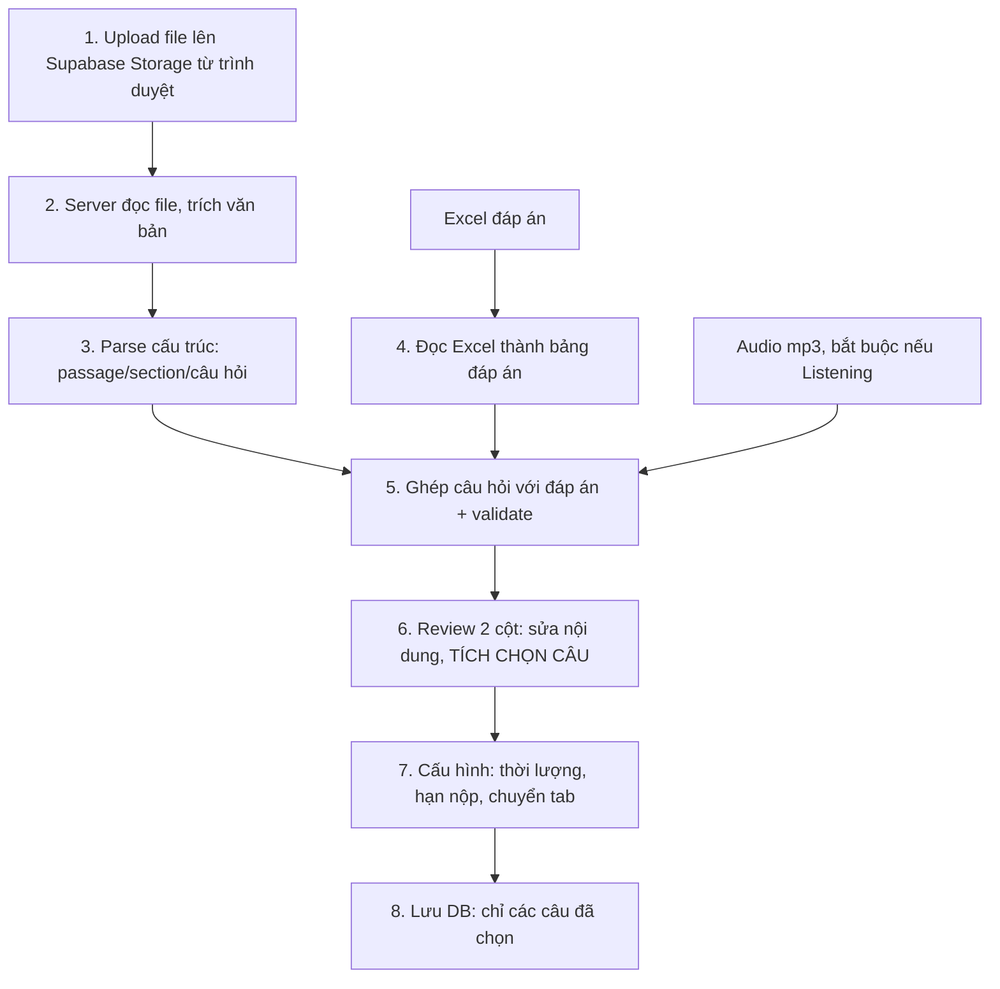

# LUỒNG: BÓC TÁCH ĐỀ IELTS (PDF/WORD) → REVIEW & CHỌN CÂU → GIAO BÀI

> Trạng thái: **ĐÃ CHỐT CÁC QUYẾT ĐỊNH CHÍNH (giai đoạn 1)**. Mục `[CHƯA CHỐT]` còn lại cần nhóm quyết định trước khi code.
> Nguồn: `KE_HOACH_TRIEN_KHAI_HOC_LIEU_VA_BAI_TAP.md` mục 2.4, `src/actions/assignments.ts` (`parseIeltsExamAction`).

## 1. Quyết định đã chốt
| # | Quyết định |
|---|---|
| 1 | **Ai tạo bài:** Teacher. Admin cũng được (để tạo bài test cho lớp). **TA và Student không được.** |
| 2 | **Định dạng đầu vào giai đoạn 1:** PDF **có chữ** (bôi đen copy được) và Word `.docx`. |
| 3 | **Giai đoạn 2 (sau):** ảnh và PDF scan, cần OCR. Giai đoạn 1 nếu gặp PDF scan thì báo "file scan, chưa hỗ trợ", không đoán. |
| 4 | **Bóc tách kiểu lai: quy tắc dọn dẹp, AI hiểu cấu trúc, code kiểm tra lại.** Dùng **Groq (LLaMA 3)**, gọi **riêng từng Part** để nhỏ, rẻ và tránh giới hạn thời gian Vercel. Xem mục 3A. |
| 4a | **Dạng câu chưa có trong CSDL** (Matching, Table Completion...): giai đoạn 1 gộp vào `FILL_IN_BLANK` hoặc đánh dấu "cần giáo viên nhập tay". **Chưa đổi `schema.prisma`.** |
| 4b | **AI không chắc về một câu:** giữ nguyên văn bản gốc, gắn cờ "cần xác nhận" ở màn Review. Không chặn cứng, không tự đoán im lặng. |
| 5 | **Chọn câu rồi giao:** giáo viên tích chọn câu muốn giao, **câu không chọn bị bỏ**, không lưu lại. Vì vậy **chưa cần thêm bảng CSDL**. |
| 6 | **Nháp khi Review:** lưu tạm bằng `localStorage` của trình duyệt, không thêm bảng. |
| 7 | **Deploy Vercel:** giáo viên upload file từ trình duyệt thẳng lên Supabase Storage; server chỉ nhận đường dẫn và đọc file về để bóc tách. Không gửi cả file qua Server Action (Vercel giới hạn khoảng 4,5MB/request và giới hạn thời gian chạy). |

## 2. Hiện trạng (đối chiếu code)
- Đã có: `parseIeltsExamAction(formData)` nhận `pdfText` (văn bản thô), `excelAnswers`, `audioUrl`; đã chặn thiếu Audio với Listening.
- `package.json` chưa có thư viện đọc PDF/docx; chỉ có `xlsx` (đọc Excel đáp án).
- Hàm parse nằm trong `assignments.ts` (~1.650 dòng): **không thêm tiếp vào file này**.

## 3. Pipeline (mỗi bước là một hàm riêng)



| Bước | Đầu vào | Đầu ra | Ghi chú |
|---|---|---|---|
| 1 Upload | PDF/docx | Đường dẫn trong Storage | Chỉ nhận `.pdf` và `.docx`; `[CHƯA CHỐT: giới hạn MB]` |
| 2 Trích văn bản | File | Văn bản thô | docx: `mammoth`; PDF có chữ: `pdfjs-dist` hoặc `unpdf`. PDF không có chữ thì báo lỗi rõ |
| 3 Parse | Văn bản thô | `ParsedExam` (JSON trung gian) | Hàm thuần, **không đụng DB** |
| 4 Đọc Excel | `.xlsx` | Danh sách đáp án (cột A–F theo mục 2.4 kế hoạch) | Dùng `xlsx` |
| 5 Ghép + validate | `ParsedExam` + đáp án | `ParsedExam` kèm cảnh báo | Xem mục 4 |
| 6 Review + chọn câu | `ParsedExam` | Danh sách câu đã tích chọn (đã sửa) | Chỉ giao diện, nháp ở `localStorage` |
| 7 Cấu hình | Câu đã chọn | Thêm thời lượng, hạn nộp, cấu hình chuyển tab | |
| 8 Lưu | Dữ liệu đã duyệt | `Assignment` + `AssignmentQuestion` + `QuestionOption` | Một transaction, tất cả hoặc không gì cả |

**Nguyên tắc:** bước 1 đến 7 **không ghi bảng `Assignment`**. Chỉ bước 8 mới ghi, nên parse lỗi không để lại bài rác.

## 3A. Chi tiết bước 3 (Parse): quy tắc + AI + kiểm tra
Đề mẫu (IELTS Mini Practice Book) có: header/footer lặp ("IELTS Mini Practice Book", "Page x of 4"), câu hỏi bị cắt giữa trang, nhiều dạng trong một đề (True/False/Not Given, trả lời ngắn, trắc nghiệm A–D, điền câu, form/table completion, Writing Task 2), và **đánh số không liên tục** (Reading 1–12, Listening lại bắt đầu từ 1).

| Bước con | Làm bằng | Việc |
|---|---|---|
| 3.1 Dọn dẹp | Quy tắc | Xóa dòng lặp ở mọi trang (header/footer), nối đoạn bị cắt giữa trang |
| 3.2 Tách Part | Quy tắc | Cắt theo tiêu đề "Part N – ..." (ổn định). Mỗi Part → một lần gọi AI |
| 3.3 Hiểu cấu trúc | **AI (Groq)** | Mỗi Part → JSON theo schema cố định: passage, nhóm câu hỏi, dạng câu, phương án, ô trống |
| 3.4 Kiểm tra | Code (zod + so khớp) | Xem mục 4. Không bao giờ lưu thẳng đầu ra AI |

Bốn nguyên tắc bắt buộc với AI:
1. **Chỉ sao chép, không sáng tác:** chép nguyên văn đề, không diễn đạt lại.
2. **Đáp án chỉ lấy từ Excel:** AI không được tự giải hay đoán đáp án.
3. **Không chắc thì `UNKNOWN`:** trả `type: UNKNOWN` kèm văn bản gốc; Review gắn cờ "cần xác nhận".
4. **Số câu theo từng Part:** mỗi Part có hệ số câu riêng, ghép Excel theo (kỹ năng, số câu), không chỉ theo số câu.

Ánh xạ dạng câu → `QuestionType` hiện có:
| Dạng trong đề | `QuestionType` |
|---|---|
| True/False/Not Given | `TRUE_FALSE_NG` |
| Trắc nghiệm A–D | `MULTIPLE_CHOICE` (chọn nhiều đáp án: `MULTIPLE_SELECT`) |
| Trả lời ngắn, điền câu, form/table completion | `FILL_IN_BLANK` |
| Writing Task | `ESSAY` |
| Matching và dạng lạ khác | `FILL_IN_BLANK` hoặc cờ "cần nhập tay" (giai đoạn 1) |

Phương án lùi: AI lỗi hoặc hết hạn mức → cho giáo viên nhập tay ở Review, không chặn hoàn toàn luồng.

## 4. Quy tắc validate
Chặn (không cho sang bước tiếp):
- Listening mà thiếu Audio.
- Không bóc được câu hỏi nào.
- Số câu trong Excel khác số câu bóc từ PDF/docx.
- Giáo viên chưa tích chọn câu nào.
- Người tạo không phải Teacher/Admin.

Cảnh báo (giáo viên sửa tay):
- Câu thiếu đáp án trong Excel, hoặc đáp án không khớp dạng câu (MCQ mà đáp án là `X`).
- Câu trắc nghiệm có ít hơn 2 phương án.
- Số thứ tự câu nhảy hoặc trùng.
- Dạng câu không nhận diện được: gắn nhãn để giáo viên chọn dạng.

## 5. Ca biên
| Ca | Cách xử lý đề xuất |
|---|---|
| PDF scan, không có chữ | Báo "file scan, chưa hỗ trợ" (giai đoạn 2 mới OCR) |
| PDF nhiều cột, chữ đảo thứ tự | Cảnh báo; giáo viên sửa ở Review |
| Passage dính vào câu hỏi | Tách theo tiêu đề "Questions x–y"; sai thì sửa ở Review |
| Câu có hình, bảng, biểu đồ (Table, Diagram labelling) | Giai đoạn 1 chưa hỗ trợ; gắn cờ để nhập tay |
| docx chứa ảnh hoặc bảng phức tạp | Chỉ lấy phần chữ; cảnh báo nếu thiếu |
| Excel thiếu cột/sai định dạng | Báo rõ cột nào, dòng nào; không parse nửa vời |
| Excel có đáp án cho Writing/Speaking | Bỏ qua (chấm tay theo rubric) |
| Bỏ chọn câu làm lệch số thứ tự | Đánh số lại theo thứ tự đã chọn; `[CHƯA CHỐT]` có giữ số gốc để đối chiếu không |
| Bấm lưu hai lần | Khóa nút, kiểm tra trùng theo tiêu đề + lớp |
| Rời trang khi đang Review | Cảnh báo; nháp lấy lại từ `localStorage` |
| Đọc file lâu (Vercel giới hạn thời gian) | Hiển thị tiến độ; `[CHƯA CHỐT]` giới hạn số trang |
| File đã upload nhưng giáo viên bỏ dở | `[CHƯA CHỐT]` dọn file rác trong Storage |

## 6. Cấu trúc code đề xuất (không thêm vào `assignments.ts` hay `simpace-app.tsx`)
```text
src/lib/exam-parser/
  extract-text.ts      # bước 2 (docx + PDF có chữ)
  parse-structure.ts   # bước 3 (hàm thuần, dễ test)
  read-answers.ts      # bước 4
  validate.ts          # bước 5
  types.ts             # ParsedExam, ParsedQuestion, ParseWarning
src/actions/exam-import.ts      # action mỏng: session + quyền (qua lib/permissions) + zod + gọi lib
src/components/assignments/exam-import/   # wizard + Review 2 cột + chọn câu (mỗi file < ~300 dòng)
scripts/test_exam_parser.ts     # chạy parser trên vài đề mẫu
```
`parse-structure.ts` và `validate.ts` là hàm thuần (nhận chuỗi, trả JSON) nên kiểm tra được bằng đề mẫu mà không cần chạy cả ứng dụng.

## 7. CSDL
Dùng lại `Assignment`, `AssignmentQuestion`, `QuestionOption`. **Không thêm bảng.** Nếu sau này cần lưu nháp trên server hoặc kho đề, bàn riêng và chỉ thêm mới.

## 8. Còn cần chốt
1. Giới hạn dung lượng file và số trang.
2. Có giữ số câu gốc khi bỏ chọn một số câu không?
3. Cách dọn file đã upload nhưng không dùng.
4. Cần vài đề mẫu thật (PDF và docx) và file Excel đáp án để chốt quy tắc parse.
5. Giai đoạn 2: chọn công cụ OCR khi bắt đầu làm.
